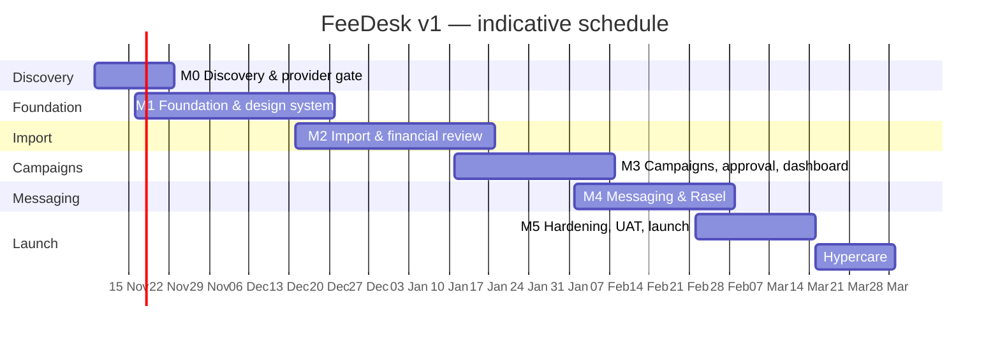
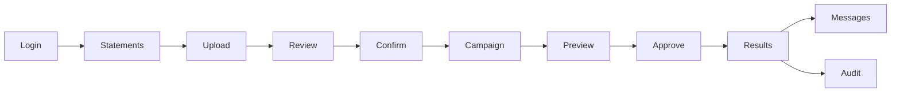
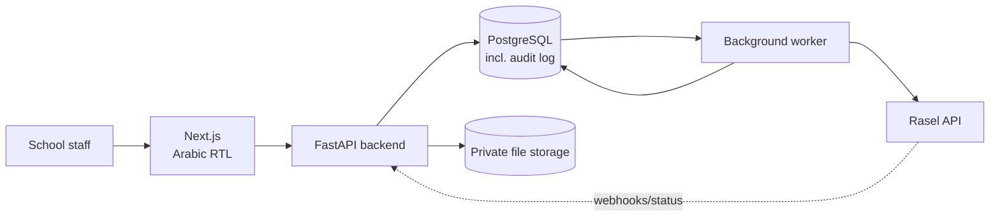

# FeeDesk — Delivery Plan & Milestone Schedule

| Field | Value |
|---|---|
| Document | FeeDesk Delivery Plan |
| Version | 1.0 |
| Status | Proposed — for approval |
| Date | 3 November 2026 |
| Source requirements | `PRD.md` — FeeDesk PRD v1.0 |
| Design reference | `FeeDesk-Dashboard.png` — approved dashboard direction |
| Document language | English |
| Product interface language | Arabic (RTL) |
| Prepared by | Delivery Lead |
| Execution status | M0 partial — G0 blocked; M1 foundation implemented, formal G1 pending (`docs/progress.md`) |
| Change control | Versioned. Material changes require Product Owner and Tech Lead approval. |

This plan converts the PRD into a gated delivery schedule. The PRD remains the source of truth for product requirements; this document owns sequencing, tasks, gates, and operating assumptions.

**Contents**

1. [Executive Summary](#1-executive-summary)
2. [Delivery Strategy](#2-delivery-strategy)
3. [Scope Baseline](#3-scope-baseline)
4. [Team, Governance, and Capacity](#4-team-governance-and-capacity)
5. [Timeline and Milestones](#5-timeline-and-milestones)
6. [Design Foundation](#6-design-foundation)
7. [Architecture and Engineering Plan](#7-architecture-and-engineering-plan)
8. [Work Breakdown and Tasks](#8-work-breakdown-and-tasks)
9. [Quality and Test Plan](#9-quality-and-test-plan)
10. [Rasel Integration Workstream](#10-rasel-integration-workstream)
11. [Operations and Launch](#11-operations-and-launch)
12. [Risk Register](#12-risk-register)
13. [Open Decisions](#13-open-decisions)
14. [Definition of Done and Launch Checklist](#14-definition-of-done-and-launch-checklist)
15. [Post-Launch Backlog](#15-post-launch-backlog)
16. [Requirement Traceability](#appendix-a--requirement-traceability)
17. [Task Register](#appendix-b--task-register)
18. [Glossary](#appendix-c--glossary)

---

## 1. Executive Summary

FeeDesk v1 is a private, single-school, Arabic-first web application that turns the school's existing Excel and PDF fee statements into reviewed balances, approved reminder campaigns, and tracked SMS messages through Rasel.

The delivery approach is deliberately **provider-first** and **review-first**:

- The Rasel route is validated against the school's real account before engineering depends on it.
- The full workflow is built end-to-end against a fake provider before live sending is enabled.
- No financial value reaches a guardian without deterministic extraction, human confirmation, campaign approval, and an immutable snapshot.
- Every milestone ends in a gate with evidence, not a status opinion.

### Plan at a glance

| Item | Baseline |
|---|---|
| Delivery duration | **18 weeks** + 2 weeks hypercare |
| Milestones | 6 delivery milestones (M0–M5) + hypercare (M6) |
| Recommended team | 3 engineers, 0.5 designer (0.75 in M1–M3), 0.5 QA, 0.2 DevOps/security, school SME |
| Estimated effort | ~315 person-days (±25%, re-baselined after M0) |
| Engineering contingency | ~15% effort contingency; schedule float concentrated in M5 and hypercare |
| Critical path | Rasel verification → schema → import confirmation → eligibility → approval transaction → worker → pilot → launch |
| Launch model | Controlled pilot first, then general school rollout |
| Expected campaign size | 10–50 recipients; tested to 100 |
| Out of scope | Full school management, accounting, payments, parent portal, multi-tenancy, WhatsApp in v1 |

### What success looks like

1. A school employee can upload a real statement, review every extracted value, correct errors, and confirm the import without any silent financial transformation.
2. Only confirmed, positive, valid, reviewed balances can enter a campaign.
3. Every recipient message is previewed before approval, and approval freezes an immutable snapshot.
4. Approved campaigns create durable jobs; the worker can restart without losing or duplicating messages.
5. Rasel acceptance and confirmed delivery are shown as separate states.
6. The school completes a controlled pilot, then approves production operation with evidence.

### Decisions required before Week 1

| # | Decision | Owner | Needed by |
|---|---|---|---|
| 1 | Approve this plan, baseline scope, and team model | School owner / Product Owner | Week 1 |
| 2 | Provide 5+ XLSX and 3+ PDF anonymized statement samples | School administration | Week 1 |
| 3 | Provide Rasel account access and API credentials | School owner | Week 1 |
| 4 | Confirm default currency, display symbol, and fee-period convention | School administration | Week 1 |
| 5 | Confirm approval policy and named approver(s) | School owner | Week 1 |
| 6 | Confirm retention, opt-out, and communication policy | School owner | Week 1 |
| 7 | Confirm hosting preference and data-location constraints | School owner | Week 2 |

If any of items 2–4 slip, M0 cannot close and the dates below are not committed. Items 5–7 must be resolved before their dependent gates (approval, privacy, deployment).

---

## 2. Delivery Strategy

### 2.1 Principles

1. **Verify externally before building internally.** Rasel account behavior and real statement formats are discovery work, not implementation assumptions.
2. **Build the spine before the edges.** Auth → import → review → confirm → eligibility → campaign → approval → jobs → results is built end-to-end with a fake provider before Rasel is wired in.
3. **Money is data, not arithmetic.** Source balances are preserved; calculated balances are validation comparisons; no float, no inference, no silent replacement.
4. **Human approval is a product feature.** The system may automate extraction, validation, filtering, and rendering. It may not authorize sending.
5. **The backend owns state.** The frontend never calls Rasel, never forces a campaign state, and never receives provider credentials.
6. **Unknown is a state, not an error to retry.** Ambiguous provider outcomes are held for reconciliation, never blindly resubmitted.
7. **Arabic-first, RTL-native.** Right-to-left is a layout and data-formatting requirement, not a CSS afterthought.
8. **One deployable unit.** Modular monolith plus worker. No microservices, Redis, or Kubernetes in v1.
9. **No AI in the financial path.** Extraction is deterministic. No model may invent, overwrite, or approve a financial value. OCR, if enabled, is an assisted input that still requires human verification.

### 2.2 Why this sequence

| Sequence decision | Rationale |
|---|---|
| M0 before any build | Rasel coverage, sender identity, pricing, and statement layouts can invalidate architecture assumptions. A one-week delay here prevents a multi-week rebuild. |
| Fake provider before Rasel | The campaign, approval, worker, retry, and results logic can be built and tested without spending SMS credit or depending on external availability. |
| Import before campaigns | Campaign eligibility depends on confirmed records, provenance, and currency rules. Building campaigns first would create a second source of truth. |
| Design system before screens | The dashboard is the only designed screen. A token and component layer prevents the remaining screens from drifting into inconsistent one-offs. |
| Dashboard after domain | The KPIs are aggregates of import, finance, campaign, and message states. Building the dashboard first would hardcode fake metrics. |
| Hardening last, but backups early | Security and UAT belong at the end; backup and restore are set up in M1 and proven before go-live. |

### 2.3 Parallel lanes

| Lane | M0 | M1 | M2 | M3 | M4 | M5 | M6 |
|---|---|---|---|---|---|---|---|
| Backend / domain | Discovery | Schema, auth, audit | Import, finance, guardians | Eligibility, approval, snapshot | Worker, adapter, statuses | Fixes, privacy | Production fixes |
| Frontend | — | Shell, design system, login | Upload, review, statements | Campaigns, preview, dashboard | Results, history, ops | UAT fixes, polish | Production fixes |
| Design | Tokens, gap list | Component library, tokens, login shell | Login/upload/review screens | Campaign/dashboard/list/settings screens | Results/history polish | RTL/a11y/visual QA | Handover polish |
| QA | Test strategy | Auth/RBAC tests | Golden files, import tests | Campaign E2E | Load/chaos, pilot | Security, UAT | Hypercare triage |
| DevOps | Hosting decision | CI, backups, observability | Parser sandbox | — | Staging provider config | Production, monitoring | Handover |
| School | Samples, policy | Settings review | Review workshop | Campaign wording | Pilot recipients | UAT, training | Post-launch review |

### 2.4 Fixed vs flexible

| Fixed (change requires gate approval) | Flexible (can move within milestones) |
|---|---|
| P0 scope in Section 3 | Exact screen layouts beyond the approved dashboard language |
| Source-balance preservation | Saved column-mapping profiles (P1) |
| Zero-balance exclusion | CSV/XLSX report export (P1) |
| Human approval and immutable snapshot | OCR depth (detection is P0; assisted OCR is bounded) |
| No automatic channel fallback | Error-tracking vendor choice |
| Arabic RTL interface | Deployment target, provided it meets privacy and backup requirements |
| One message job per personalized recipient | Worker concurrency and pacing values |

### 2.5 Pilot ladder

| Stage | Audience | Provider | Purpose | Exit criterion |
|---|---|---|---|---|
| Pilot 0 — Internal | Team | Fake adapter | Full workflow, duplicate/retry/chaos tests | All E2E and failure tests pass |
| Pilot 1 — Technical | 3 school-controlled numbers | Rasel live | Verify route, sender, encoding, status | Message received and provider record reconciled |
| Pilot 2 — Controlled school | 5–10 consented guardians | Rasel live | Verify real balances, wording, delivery, support | School sign-off on results |
| Pilot 3 — General rollout | All eligible guardians | Rasel live | Normal operation | Hypercare exit |

No production bulk campaign is the first integration test.

---

## 3. Scope Baseline

### 3.1 Version 1 — P0 scope

| Module | P0 outcome | Milestone |
|---|---|---|
| Identity | Login, logout, sessions, Administrator/Staff roles, backend-enforced permissions, inactive-user block, password hashing | M1 |
| School settings | School name, currency, locale, timezone, contact details, templates, provider configuration, batch/send limits, audit | M1–M4 |
| Import | XLSX/PDF upload, validation, batch lifecycle, sheet selection, column mapping, staging, review, correction, duplicate handling, confirmation | M2 |
| Finance | Decimal money storage, explicit currency, source balance preservation, calculated comparison, negative/discrepancy flags, corrections with history | M2 |
| Guardians | Contact records, multiple fee entries per guardian, phone normalization, original preservation, invalid/shared-phone flags, manual identity resolution | M2 |
| Eligibility | Confirmed + positive + valid currency + valid contact + not excluded/blocked/duplicated; visible exclusion reasons | M3 |
| Campaigns | Creation from confirmed records, grouping, recipient preview, draft lifecycle, cancellation, approval, immutable snapshot, results | M3–M4 |
| Templates | Arabic templates, approved variables, fallbacks, version retention, rendered-message snapshots, unresolved-variable blocking | M3 |
| Messaging | Rasel adapter, credential protection, test send, durable jobs, idempotency, retries, status mapping, unknown-outcome handling, partial failures | M4 |
| Background processing | PostgreSQL-backed worker, safe claiming, restart recovery, no concurrent duplicate processing, pacing, diagnostics | M4 |
| Audit | Actor, timestamp, action, entity, before/after, import/campaign linkage, append-only access | M1–M5 |
| Dashboard and reporting | Actionable KPIs, totals by currency, pending reviews/approvals, recent failures, provider status, import/campaign summaries, message history, audit log | M3–M4 |
| Operations | HTTPS, private storage, backups, restore drill, monitoring, runbooks, training, UAT | M5 |

### 3.2 P1 — deferred, not launch-blocking

| Item | Why deferred | Revisit |
|---|---|---|
| Saved column-mapping profiles | Useful after the same layout repeats; not required for first imports | After 3 real imports |
| CSV import | PRD allows later; XLSX/PDF cover current sources | Post-launch |
| XLSX/CSV report export | School may need downloadable reports; not required for pilot | Post-launch |
| Email-based password reset | Users may not have school email; admin reset is sufficient initially | If SMTP is available |
| Multi-factor authentication | School security policy does not require it yet | If policy changes |
| Scheduled campaigns | Manual campaigns cover the initial workload | Post-launch |
| Guardian management page | Contextual views are sufficient initially | If usage proves need |
| OCR quality improvements | Detection and manual verification are the safe v1 behavior | After sample review |
| WhatsApp official channel | Syrian route unverified; hard-disabled | Only after written verification |
| Additional providers | Adapter exists; no second provider in v1 | Future |

### 3.3 Explicitly out of scope

Attendance, enrollment, teachers, classes, timetables, exams, grading, general accounting, bookkeeping, invoicing, reconciliation, online payments, payment gateways, parent/student apps, parent portal, multi-school tenancy, SaaS billing, AI chatbot, AI financial calculations, WhatsApp Web session automation, marketing automation, complex BI dashboards. Standalone images and photographs are also out of scope; scanned PDFs are detected, but OCR is an assisted fallback requiring human verification.

### 3.4 Scope control

- Every change request is logged with: request, reason, affected requirements, estimate, risk, and gate impact.
- Changes that touch money, approval, provider messaging, or security require Tech Lead and Product Owner approval.
- P1 items do not enter a milestone unless a P0 item is removed or the schedule is re-baselined.
- No "while we are here" additions inside a gate.

---

## 4. Team, Governance, and Capacity

### 4.1 Recommended team

| Role | FTE | Responsibilities |
|---|---:|---|
| Product Owner / Delivery Lead | 0.5 | Scope, priorities, school communication, gate facilitation, acceptance |
| Tech Lead | 1.0 | Architecture, schema, security, provider integration, code review, ADRs |
| Backend Engineer | 1.0 | Import, finance, guardians, campaigns, worker, API |
| Frontend Engineer | 1.0 | Arabic RTL UI, design system, all screens, accessibility |
| Product Designer | 0.5 average; 0.75 in M1–M3 | Token/component library, remaining screens, RTL and visual QA |
| QA Engineer | 0.5 | Test strategy, golden files, E2E, failure/load tests, UAT support |
| DevOps / Security | 0.2 | CI, environments, deployment, backups, monitoring, security review |
| School SME / Administrator | 0.2 | Samples, conventions, wording, approval policy, UAT, training |

#### Stakeholders

| Stakeholder | Interest | Engagement |
|---|---|---|
| School owner | Launch approval, communication policy, budget | Gate reviews, go/no-go |
| School administrator (SME) | Daily workflow, wording, approvals | Weekly review, UAT, training |
| Finance/administrative staff | Import review, campaign preparation | Workshops, UAT |
| Rasel account manager | Sender, coverage, pricing, delivery reporting | M0 verification, pilot |
| Hosting/provider | Uptime, backups, data location | Deployment and operations |
| Guardians | Accurate, respectful, infrequent reminders | Indirect; message copy and opt-out policy |

### 4.2 Capacity scenarios

| Scenario | Team | Duration | Trade-off |
|---|---|---|---|
| **A — Recommended** | 3 engineers + designer (0.5 avg, 0.75 in M1–M3) + 0.5 QA | **18 weeks** + 2 hypercare | Balanced; frontend and backend proceed in parallel; programme contingency held across M5 and hypercare |
| B — Lean | 2 engineers + 0.5 designer + 0.5 QA | 24–26 weeks | Frontend and backend serialize more; dashboard and history screens may slip to post-launch |
| C — Solo | 1 full-stack engineer + part-time design/QA | 40–48 weeks | Not recommended for the P0 scope; high key-person risk; no parallel discovery |
| D — Accelerated | 4 engineers + 1 designer + 1 QA | 14–15 weeks | Possible only after M0; coordination cost and review load rise; not recommended before provider verification |

The baseline dates assume Scenario A. Scenario B is viable with a reduced first release: dashboard trends, message-history filters, and report exports can move to P1.

### 4.3 RACI

| Activity | Product Owner | Tech Lead | Engineering | Design | QA | School |
|---|---|---|---|---|---|---|
| Scope and priorities | A | C | I | I | I | C |
| Statement conventions | C | R | C | — | I | A |
| Architecture and security | I | A/R | R | — | C | I |
| Design system and screens | C | C | C | A/R | C | I |
| Implementation | I | A | R | C | C | I |
| Test strategy and evidence | I | C | C | — | A/R | I |
| Campaign wording and policy | C | I | I | C | I | A |
| UAT and launch approval | R | C | C | C | C | A |
| Production operations | I | A | R | — | C | I |

R = responsible, A = accountable, C = consulted, I = informed.

### 4.4 Ceremonies and reporting

| Ceremony | Cadence | Output |
|---|---|---|
| Async stand-up | Daily | Blockers, decisions needed, risk changes |
| Weekly demo and status | Weekly | Working increment, RAG status, next week, decisions |
| Gate review | End of each milestone | Evidence pack, pass/fail, conditions, sign-off |
| Risk and decision review | Bi-weekly | Updated RAID log and decision log |
| School review | At M0, M1 settings, M2, M3, M4 pilot, M5 | Sample review, wording approval, pilot, UAT |
| Change board | As needed | Approved/rejected change with impact |

Status uses RAG with definitions: Green = on plan, no gate risk; Amber = one recoverable issue with a named owner and date; Red = gate at risk or scope/quality trade-off required.

Each gate evidence pack contains: the signed checklist, demo notes or screenshots, CI/test report, open risks and decisions, and the updated schedule/effort view.

### 4.5 Definition of Ready

A task is ready when:

- Its outcome and acceptance evidence are written.
- Dependencies are met or explicitly scheduled.
- Design or copy is available, or the task is explicitly backend-only.
- Test data or fixtures exist.
- Security/privacy implications are identified.

### 4.6 Definition of Done

A task is done when:

- Code is reviewed and merged.
- Automated tests cover the behavior and pass in CI.
- Error, empty, and permission states are handled.
- Audit events are emitted where required.
- No secret, real phone number, or real statement is in the repository.
- Documentation or runbook impact is updated.
- Acceptance evidence is attached to the task.

A milestone is done only when its gate checklist passes. A release is done only when the launch checklist in Section 14 passes.

---

## 5. Timeline and Milestones

### 5.1 Milestone summary

| ID | Milestone | Weeks | Duration | Primary output | Gate |
|---|---|---|---:|---|---|
| M0 | Discovery and Provider Validation | W1–W2 | 2 weeks | Validated samples, Rasel evidence, decisions, ADRs | G0 |
| M1 | Foundation and Design System | W2–W6 | 5 weeks | Auth, schema, audit, storage, shell, tokens, CI, backup | G1 |
| M2 | Import and Financial Review | W6–W10 | 5 weeks | XLSX/PDF import, review, validation, confirm, guardians | G2 |
| M3 | Campaigns, Approval, and Dashboard | W10–W13 | 4 weeks | Eligibility, templates, preview, approval, snapshot, dashboard | G3 |
| M4 | Messaging and Rasel | W13–W16 | 4 weeks | Worker, adapter, statuses, retries, pilot | G4 |
| M5 | Hardening, UAT, and Launch | W16–W18 | 3 weeks | Security, backups, UAT, training, production launch | G5 |
| M6 | Hypercare and Handover | W19–W20 | 2 weeks | Stabilization, handover, post-implementation review | Close |

**Indicative calendar** (assuming a 9 November 2026 start): launch in the week of 8 March 2027; hypercare through 26 March 2027. Dates are commitments only after G0.



Milestone windows overlap by one week at their edges for design/QA ramp-up and non-dependent scaffolding (for example, FND-01–04 in W2). Overlap is not permission to start dependent work before its gate; a gate failure stops dependent implementation, not already-approved scaffolding.

### 5.2 Critical path

```
M0 Rasel + sample validation
  → M1 schema + audit + storage
    → M2 import confirmation transaction
      → M3 eligibility + approval snapshot
        → M4 durable jobs + worker + provider reconciliation
          → M5 UAT + launch
            → M6 hypercare + handover
```

Secondary critical path: M0 sample taxonomy → M2 XLSX/PDF parsers → M2 review UI → M3 campaign preview. PDF variability is the most likely schedule threat after Rasel.

### 5.3 Gate criteria

#### G0 — Discovery and Provider Validation

- [ ] Scope, team model, and 18-week baseline approved.
- [ ] At least 5 XLSX and 3 PDF anonymized samples received, including one multi-sheet and one scanned PDF.
- [ ] Statement taxonomy documented: columns, money formats, currencies, fee periods, guardian/student mapping.
- [ ] Rasel account active; API access enabled; credentials stored in the team vault, not in chat or source.
- [ ] Written confirmation of API version, send endpoint, local SMS channel, sender identity, Syrian coverage, fee-reminder use case, pricing, segment rules, rate limits, idempotency, and delivery reporting.
- [ ] Controlled test SMS delivered to 3 school-controlled numbers across relevant networks; evidence filed.
- [ ] Currency/symbol, approval policy, retention, opt-out, hosting, and Arabic wording decisions recorded.
- [ ] Design token baseline and screen gap list approved.
- [ ] ADRs 001–008 accepted.

**If G0 fails:** do not start dependent M1 implementation (domain, schema, auth, provider work). Only non-dependent scaffolding may continue at risk. Continue discovery and re-baseline the schedule.

#### G1 — Foundation and Design System

- [ ] CI runs lint, typecheck, unit tests, migration check, secret scan, and build.
- [ ] Schema v1 migrated up and down cleanly on an empty database.
- [ ] Login, logout, session expiry, inactive-user block, and lockout pass.
- [ ] Every protected route has a permission test; Staff cannot reach admin settings.
- [ ] Admin can create/deactivate a user and force a password change.
- [ ] School settings persist and are audited.
- [ ] Audit events are append-only and include actor, timestamp, action, entity, before/after.
- [ ] Private file upload/download works only through authenticated endpoints.
- [ ] App shell, tokens, typography, RTL, and core components match the approved direction.
- [ ] Login screen works in Arabic RTL on desktop and 1024px tablet.
- [ ] Backup job runs and a restore has been performed in a non-production environment.
- [ ] Structured logs, health endpoints, and PII redaction are active.

#### G2 — Import and Financial Review

- [ ] Every M0 sample file processes to the expected normalized output, or fails with a clear, actionable reason.
- [ ] Multi-sheet workbooks list sheets and require selection.
- [ ] Column mapping can be auto-suggested and manually corrected.
- [ ] Extracted rows retain source row/page references.
- [ ] Money parsing handles Arabic-Indic digits, separators, and currency suffixes without floats.
- [ ] Phone normalization produces E.164 where possible and flags invalid/ambiguous numbers.
- [ ] Negative balances, conflicting totals, missing currency, missing guardian, and duplicate candidates are flagged.
- [ ] Zero-balance records remain stored but are marked ineligible.
- [ ] Import confirmation is transactional and idempotent; a failed confirmation leaves no partial records.
- [ ] Corrections preserve before/after values and actor.
- [ ] Duplicate file upload requires explicit override with a reason and audit event.
- [ ] Guardian identity is never auto-merged on shared phone alone.
- [ ] Import history shows status, counts, uploader, date, and error summary.
- [ ] Golden-file and property tests pass in CI.

#### G3 — Campaigns, Approval, and Dashboard

- [ ] A campaign can be created only from confirmed records.
- [ ] Eligible and excluded records are shown with reasons.
- [ ] Guardian grouping preserves individual fee lines and never combines currencies.
- [ ] Every recipient message can be previewed exactly as it will be sent.
- [ ] Unresolved template variables block submission for approval.
- [ ] A draft cannot be sent.
- [ ] Only an authorized approver can approve; preparer and approver are recorded.
- [ ] Approval freezes an immutable snapshot and creates messages/jobs in one transaction.
- [ ] A failed approval transaction leaves no partial campaign state.
- [ ] Editing a guardian or balance after approval does not change the snapshot.
- [ ] Cancellation is audited and blocked after terminal completion.
- [ ] Dashboard shows totals by currency, eligible guardians, pending reviews, pending approvals, recent failures, and a provider-status placeholder until M4.
- [ ] Dashboard trend deltas appear only when a historical snapshot exists.
- [ ] E2E create → preview → approve passes; approval creates jobs but sends nothing.

#### G4 — Messaging and Rasel

- [ ] Rasel credentials are encrypted at rest, masked in UI, and absent from frontend bundles, logs, and API responses.
- [ ] A controlled test message reaches a school-controlled number and is reconciled against the provider record.
- [ ] One durable job exists per personalized recipient; no shared-body batch is used for personalized content.
- [ ] Worker claims jobs safely; two workers cannot process the same message concurrently.
- [ ] Worker restart mid-campaign loses no job and creates no duplicate logical message.
- [ ] Idempotency keys are stable across retries and unique per message.
- [ ] Provider acceptance, queued, delivered, failed, and unknown are distinct states.
- [ ] A timeout produces `unknown`, not an automatic resend.
- [ ] Rate-limit, insufficient-balance, invalid-key, unsupported-destination, and partial-failure scenarios behave as specified.
- [ ] Campaign status is derived from message outcomes; partial failures are visible.
- [ ] Results and message-history screens show submission, acceptance, delivery, failure, and unknown states without conflating them.
- [ ] 100-recipient load test passes within the agreed pacing.
- [ ] Pilot evidence is signed off by the school.
- [ ] WhatsApp remains disabled unless its exact Syrian route is verified in writing.

#### G5 — Hardening, UAT, and Launch

- [ ] All P0 acceptance criteria in PRD Section 17 pass.
- [ ] Security review findings are closed or explicitly accepted with compensating controls.
- [ ] API permission matrix tests pass for every role/route pair.
- [ ] Sensitive data is redacted from logs and masked where full values are unnecessary.
- [ ] Retention purge and deletion runbook are tested.
- [ ] Backup and restore drill evidence is attached; RPO/RTO targets are met.
- [ ] Production deployment is HTTPS-only, private storage is enforced, and secrets are injected outside source.
- [ ] Monitoring alerts fire for downtime, queue stall, failed jobs, low provider balance, and backup failure.
- [ ] Runbooks are reviewed: deploy, rollback, worker recovery, unknown outcomes, provider outage, key rotation.
- [ ] A school employee who did not build the system completes the full workflow in UAT.
- [ ] Arabic training guide and training session are complete.
- [ ] Launch checklist and go/no-go are signed.

### 5.4 Schedule assumptions and confidence

| Assumption | Impact if false |
|---|---|
| Samples arrive in Week 1 and are representative | Parser work slips; PDF scope may need narrowing |
| Rasel account access is available in Week 1 | M4 cannot start; launch date moves |
| School SME is available for weekly reviews | Wording, taxonomy, and UAT delays |
| Hosting decision by Week 2 | M5 deployment compresses; launch risk |
| No P0 scope added after G1 | Timeline and quality trade-off |
| One full-time frontend engineer | Screens serialize; 18 weeks becomes 24+ |
| Year-end holiday period reduces school/design availability | Absorbed by programme contingency; gate dates may shift one week |
| School office has reliable internet and a modern browser | Users cannot operate; add connectivity contingency or offline process |

**Confidence:** medium. The engineering estimate is credible; the external dependencies (Rasel, sample quality, school availability) dominate the risk. Re-baseline after G0, not before.

### 5.5 Dependencies

| Dependency | Needed by | Owner | Consequence if late |
|---|---|---|---|
| Anonymized XLSX/PDF samples | W1 | School | Parser scope unknown; G0 cannot close |
| Rasel account, API access, sender identity | W1–W2 | School / Rasel | M4 and live pilot blocked |
| Arabic message wording and opt-out policy | W1–W3 | School | Templates and approval blocked |
| Currency, symbol, fee-period conventions | W1 | School | Financial validation and UI labels blocked |
| Hosting and data-location decision | W2 | School | M5 deployment compresses |
| Retention and deletion policy | W1 | School | Privacy controls cannot be finalized |
| UAT participants and authorized data | W16 | School | Launch gate cannot pass |
| Domain, DNS, and server access | W15 | School / IT | Production deployment blocked |
| Rasel pricing, segments, rate limits | G0 | Rasel | Cost display and pacing cannot be finalized |

### 5.6 Commercial notes

- The recommended stack is open source: Next.js, FastAPI, PostgreSQL, and IBM Plex Sans Arabic (SIL OFL). There are no per-seat licence fees for the core stack.
- Cost drivers are hosting/VPS, encrypted backup storage, SMS segments, optional error tracking, and the design/QA/security effort in this plan.
- SMS spend is variable and is not committed until G0 confirms segment pricing, volume, and retry behavior.
- No payment gateway, SMS resale, or multi-tenant infrastructure is included.
- Scope changes are estimated separately and go through the change board.

---

## 6. Design Foundation

The approved dashboard establishes the visual language. It is one screen, not a complete product design. The plan treats the mockup as the **visual contract** and requires the designer to extend it into a component library and the remaining screens before frontend work begins on each area.

### 6.1 Design intent

- Calm, institutional confidence appropriate to a private school.
- Warm paper background, deep forest green, muted status colors.
- Generous whitespace; few borders; no gradients, glassmorphism, or decorative AI visuals.
- Arabic-first hierarchy; Latin numerals for financial scanning.
- Tables and action lists over charts. Sparklines are optional and never the only way to read a value.
- Every screen answers an operational question and offers a next action.
- The sidebar watercolor school-building illustration is a brand asset: keep it low-contrast, hide it below 1024px, and never let it compete with navigation.

### 6.2 Observed token baseline

These values are sampled from the approved mockup for continuity, with contrast-safe text variants added. The designer owns final values and contrast validation (DES-01).

| Token | Value | Usage |
|---|---|---|
| `--fd-bg` | `#F9F7F4` | App background |
| `--fd-surface` | `#FDFCFA` | Cards, panels, tables |
| `--fd-surface-alt` | `#F4F2EC` | Table headers, hover rows |
| `--fd-sidebar` | `#EFEEE8` | Sidebar |
| `--fd-line` | `#E4E0D6` | Default border |
| `--fd-line-strong` | `#D6D1C4` | Inputs, dividers |
| `--fd-ink` | `#1D1D23` | Primary text |
| `--fd-ink-muted` | `#5D6060` | Secondary text |
| `--fd-ink-subtle` | `#6B6F6C` | Meta text (4.77:1 on app background) |
| `--fd-brand` | `#314C3B` | Primary button, active nav |
| `--fd-brand-strong` | `#243B2D` | Hover/pressed |
| `--fd-brand-soft` | `#E7EEE7` | Tinted surfaces |
| `--fd-green` | `#3E6B4F` | Success icon |
| `--fd-green-soft` | `#E4EFE5` | Success pill background |
| `--fd-green-text` | `#2F5A3D` | Success pill text (6.7:1 on soft) |
| `--fd-amber` | `#A78E66` | Warning icon |
| `--fd-amber-soft` | `#F7EBD6` | Warning pill background |
| `--fd-amber-text` | `#7A5A24` | Warning pill text (5.4:1 on soft) |
| `--fd-red` | `#C0392B` | Error/danger icon |
| `--fd-red-soft` | `#F9E1DE` | Error pill background |
| `--fd-red-text` | `#8F2D22` | Error pill text (6.6:1 on soft) |
| `--fd-focus` | `#314C3B` | Focus ring |

Rules:

- Pill text uses the dedicated darker text tokens, not the icon color, to meet 4.5:1. The raw amber/red/green values are for icons and fills, not small text.
- Body text uses `--fd-ink` or `--fd-ink-muted`; `--fd-ink-subtle` is the lightest permitted text and meets 4.5:1 on the app background.
- Status is never conveyed by color alone; include a label and icon/dot.
- No pure white cards on pure white backgrounds; preserve the warm paper relationship.
- Shadows are subtle: `0 1px 2px rgba(29,29,35,.04)` and `0 8px 24px rgba(29,29,35,.06)` for overlays only.

### 6.3 Typography and numerals

| Item | Specification |
|---|---|
| UI typeface | IBM Plex Sans Arabic (SIL OFL), weights 400/500/600/700; fallback Noto Sans Arabic, Segoe UI, Tahoma |
| Wordmark | Supplied SVG asset; do not typeset or substitute |
| Body | 14px / 1.6 |
| Table | 13px / 1.5 |
| Labels | 13px / 500 |
| Page title | 30–32px / 700 |
| KPI number | 32–36px / 700, tabular |
| Caption/meta | 12px / 400 |
| Letter spacing | 0 for Arabic; no artificial tracking |
| Numerals | Latin digits (0–9), `ar-SY-u-nu-latn`, tabular |
| Currency | ISO code stored; display symbol from settings; render as suffix with a smaller size |
| Dates | `ar-SY`, Gregorian, Levantine month names, 24-hour time; default timezone `Asia/Damascus`; e.g. `السبت، 16 آب 2025`, `14:32` |
| Phone/IDs | LTR-isolated with `<bdi dir="ltr">`; never reorder digits |

The mockup uses Latin digits and `د.س`. The symbol is treated as configuration, not a constant. Confirm it in OD-01.

### 6.4 Layout and spacing

| Item | Specification |
|---|---|
| Sidebar | 240px on the right; 72px collapsed; logo top, nav, illustration bottom, version |
| Topbar | 72px; user block, notification/action badge, date; actions align to inline-end |
| Content | Max 1440px; 24px gutters; 12-column grid; 16px card gap |
| Page header | Title/subtitle inline-start; primary action inline-end |
| Card radius | 16px |
| Control radius | 10px |
| Pill radius | 999px |
| Table row | 52px; 44px minimum touch target |
| Breakpoints | 1280 desktop, 1024 tablet, 768 narrow; tables scroll horizontally rather than crush |
| Density | Comfortable, not compact; school staff use this daily, not power users |

### 6.5 RTL rules

- `<html lang="ar" dir="rtl">`; all spacing uses logical properties (`margin-inline-start`, `padding-inline-end`).
- Mirror directional icons only (back/forward, chevrons, progress). Do not mirror the logo, checkmarks, media controls, or phone icons.
- Tables: first column on the right; headers align with their data; numeric columns use tabular numerals and align to inline-end.
- Forms: labels and inputs right-aligned; validation icon on the inline-end; error text below the field.
- Progress and steppers fill right-to-left.
- Dialogs, toasts, and drawers use logical placement; test at 1024px.
- Keyboard Tab order follows the RTL visual order; verify focus rings are never clipped.
- Mixed Arabic/Latin strings use `<bdi>` to prevent punctuation jumps.

### 6.6 Component inventory

| Group | Components |
|---|---|
| Shell | AppShell, SidebarNav, Topbar, PageHeader, Breadcrumbs, UserMenu, NotificationBadge |
| Actions | Button (primary/secondary/ghost/danger), IconButton, LinkButton, SplitButton (only if needed) |
| Data display | Card, StatCard, Sparkline, DataTable, TableToolbar, FilterBar, Pagination, StatusPill, Badge, ProgressBar, MaskedValue, CopyButton |
| Feedback | Alert/Banner, Toast, EmptyState, ErrorState, Skeleton, ConfirmDialog, Dialog, Drawer, Tooltip |
| Forms | FormField, Input, Textarea, PhoneInput, CurrencyInput, Select, Combobox, Checkbox, Radio, FileDropzone, Stepper, TemplateEditor, VariableChip |
| Domain | ActionList, ActivityFeed, ImportSummary, ValidationMessage, RecipientTable, MessagePreview, CampaignSummary, AuditDiff, ProviderStatus |
| Navigation | Tabs, SegmentedControl, SidebarSection, FilterTabs |

Every component needs: default, hover, focus-visible, active, disabled, loading, error, and RTL states where applicable.

### 6.7 Screen inventory

The dashboard is designed. The remaining screens must be produced in the same language before their frontend milestone.

**Primary navigation (right sidebar, in order):**

| # | Arabic label | Route | Visibility |
|---|---|---|---|
| 1 | الرئيسية | `/` | All users |
| 2 | كشوف الأقساط | `/statements` | All users |
| 3 | الحملات | `/campaigns` | All users |
| 4 | سجل الرسائل | `/messages` | All users |
| 5 | سجل العمليات | `/audit` | Administrators; Staff may see a scoped activity view |
| 6 | الإعدادات | `/settings` | Administrators; Staff may see profile only |

The topbar shows the current user, role, action/notification badge, and localized date, matching the approved direction. The badge is derived from the action queue (pending reviews, pending approvals, recent failures); it is not a separate notification inbox. Email and push notifications are out of scope for v1.

| # | Route | Screen | Key content | Milestone |
|---|---|---|---|---|
| 1 | `/login` | Login | School identity, username/password, error, session-expired message | M1 |
| 2 | `/` | Home dashboard | 4 KPI cards, action queue, recent campaigns/failures summary, activity table, provider-status placeholder | M3 |
| 3 | `/statements` | Fee statements | Upload CTA, import history, date, filename, uploader, row counts, status, review action, error summary | M2 |
| 4 | `/statements/upload` | Upload wizard | File drop, validation, sheet selection, column mapping, progress | M2 |
| 5 | `/statements/:id/review` | Import review | Editable table: guardian, phone, student/reference, paid, remaining, currency, validation, source; row errors, filters, duplicate resolution, confirm | M2 |
| 6 | `/statements/:id` | Import detail | Metadata, counts, error summary, source file, audit | M2 |
| 7 | `/campaigns` | Campaigns | Tabs: draft, awaiting approval, approved, sending, completed, failed; name, date, recipient count, totals by currency, status, creator, approver | M3 |
| 8 | `/campaigns/new` | Campaign builder | Source selection, eligible/excluded panels, grouping, currency summary | M3 |
| 9 | `/campaigns/:id` | Campaign review/approval | Summary, channel, excluded/invalid counts, estimated cost if available, recipient table, message preview, warnings, approve | M3 |
| 10 | `/campaigns/:id/results` | Campaign results | Progress, totals by currency, excluded count, submitted/accepted/delivered/failed/unknown, estimated/actual cost if available, completion time, per-recipient detail | M4 |
| 11 | `/messages` | Message history | Filters: guardian, phone, campaign, date, state, channel | M4 |
| 12 | `/messages/:id` | Message detail | Original campaign, body, destination, timestamps, provider references, delivery events, retry history | M4 |
| 13 | `/audit` | Audit log | Actor, action, entity, timestamp, before/after, filters | M4 |
| 14 | `/settings/*` | Settings | School, currency/locale, templates, users, provider, limits | M1–M4 |
| 15 | Drawer | Guardian context | Contact, fee lines, campaign history, identity resolution | M2–M3 |
| 16 | — | Error/system | 403, 404, 500, offline, session expired | M1 |



### 6.8 Status and label dictionary

Labels are proposals for design and school review; the backend enum is the source of truth. The school name `مدرسة الروض الخاصة` and the job title `مدير الشؤون المالية` in the mockup are sample profile data, not hardcoded strings or role names.

| Role | Arabic display label |
|---|---|
| Administrator | مدير النظام |
| Staff | موظف إداري |

#### Import batch

| State | Arabic label | Tone |
|---|---|---|
| `uploaded` | تم الرفع | Neutral |
| `processing` | قيد المعالجة | Info/neutral |
| `review_required` | بانتظار المراجعة | Amber |
| `ready_to_confirm` | جاهز للتأكيد | Green-soft |
| `confirmed` | مكتملة | Green |
| `failed` | فشل | Red |
| `cancelled` | ملغاة | Neutral |

#### Campaign

| State | Arabic label | Tone |
|---|---|---|
| `draft` | مسودة | Neutral |
| `review_required` | بانتظار المراجعة | Amber |
| `awaiting_approval` | بانتظار الاعتماد | Amber |
| `approved` | معتمدة | Green-soft |
| `queued` | في قائمة الإرسال | Info |
| `sending` | قيد الإرسال | Info |
| `completed` | مكتملة | Green |
| `completed_with_errors` | مكتملة مع أخطاء | Amber/red |
| `failed` | فشلت | Red |
| `cancelled` | ملغاة | Neutral |

Campaign completion means the submission process finished, not that every message was delivered. The results screen must show delivery separately.

#### Message

| State | Arabic label | Tone |
|---|---|---|
| `pending` | قيد الانتظار | Neutral |
| `submitting` | قيد الإرسال | Info |
| `provider_accepted` | تم الإرسال إلى المزود | Green-soft |
| `queued_by_provider` | في قائمة المزود | Info |
| `delivered` | تم التسليم | Green |
| `failed` | فشل | Red |
| `unknown` | الحالة غير معروفة — قيد المطابقة | Amber/red |
| `cancelled` | ملغاة | Neutral |

**Copy accuracy rule:** never display `تم التسليم` unless the provider has explicitly confirmed delivery. `تم الإرسال` alone is ambiguous and must not be used for provider acceptance; use `تم الإرسال إلى المزود`. The mockup's `تم الإرسال` label should be corrected in implementation.

### 6.9 Dashboard metric definitions

| Metric | Definition | Notes |
|---|---|---|
| إجمالي المستحقات | Sum of confirmed `remaining_balance > 0`, **grouped by currency** | Never one total across currencies; stack or tab per currency |
| أولياء الأمور المستحقون | Distinct guardians with at least one eligible confirmed positive balance | Not the number of fee rows |
| كشوف بانتظار المراجعة | Import batches in `review_required` or `ready_to_confirm` | Actionable count |
| حملات بانتظار الاعتماد | Campaigns in `awaiting_approval` | Actionable count |
| رسائل تعذر إرسالها | Messages in `failed` in the last 30 days | Excludes `unknown`; show separately |
| Trend delta | Current value vs daily snapshot ~30 days prior | Show only if a baseline exists; otherwise `—` |
| Rasel status | Last successful test/health check | Do not show live balance unless the provider returns it |

The mockup's deltas (`+12%`, `+8%`, `0%`) require historical snapshots. Plan RPT-03 creates them from day one; until 30 days of data exist, the UI shows no delta rather than inventing one.

### 6.10 Content and tone

- Arabic: formal, calm, direct; no blame and no technical jargon.
- Errors state what happened, why, and the next action.
- Confirmation is required for approve, cancel, override duplicate, and resend-as-new.
- Amounts always carry a currency; zero is written `0` with currency, not hidden.
- Exclusion reasons are plain Arabic, e.g. `الرصيد صفر — لا حاجة لتذكير`.
- Student names are optional. Default SMS copy should omit student names unless the school explicitly requires them (OD-03).
- Phone numbers are masked in lists (`+963 9•• ••• 123`) and revealed on explicit action.
- Never expose provider keys, raw payloads, or internal error codes to staff; show a translated message and a reference.
- Avoid exclamation marks and urgency language; this is a fee reminder, not marketing.

### 6.11 Accessibility

Target WCAG 2.2 AA:

- Contrast 4.5:1 for text, 3:1 for large text and UI boundaries.
- Full keyboard operation; visible focus ring; no focus traps.
- Semantic table headers, captions, and scope.
- Form labels, descriptions, and error associations; live-region announcements for async errors.
- Status not conveyed by color alone.
- 200% zoom without loss of function; 44px touch targets.
- Arabic screen-reader spot check on login, review, preview, and approval.
- Reduced-motion support; no essential animation.
- `lang="ar"` and `dir="rtl"` on the document; LTR isolation for phone/IDs.

### 6.12 Design deliverables

| Deliverable | Owner | Due |
|---|---|---|
| Token sheet | Designer | M0/G0 |
| Component specs and Figma library for all states | Designer | M1 |
| Login, upload wizard, import review screens | Designer | M1–M2 |
| Campaign builder, review/approval, results screens | Designer | M2–M3 |
| Statements, campaigns, messages, audit, settings, empty/error states | Designer | M3 |
| Arabic copy deck and status labels | Designer + school | M1, updated M3 |
| RTL and accessibility audit | Designer + QA | M5 |
| Visual QA against approved screens | Designer | Each frontend gate |

**Design risk:** only one screen is designed. Sixteen screen entries (including drawers, error, and system states) plus their states are in scope. The design lane must stay at least one milestone ahead of frontend, or the frontend will invent patterns.

---

## 7. Architecture and Engineering Plan

### 7.1 Stack decisions

| Layer | Decision | Why | Rejected alternative |
|---|---|---|---|
| Frontend | Next.js (App Router) + TypeScript strict | Arabic RTL, server rendering, one deployable app, strong typing | Separate SPA + API (more moving parts) |
| Styling | Tailwind + CSS variables from tokens | Fast, consistent, no heavy UI kit to fight | Component library with foreign design language |
| Data fetching | Server components for initial load; TanStack Query for interactive views | Simple, cache-aware, testable | Ad-hoc fetch in every component |
| Tables | TanStack Table headless | Full control over RTL and design | Opinionated grid with licensing/design mismatch |
| Forms | React Hook Form + Zod | Field-level errors, shared validation | Uncontrolled forms |
| Backend | Python + FastAPI | Typed API, OpenAPI, strong parsing ecosystem | Node-only backend (weaker PDF/XLSX tooling) |
| ORM/migrations | SQLAlchemy 2 + Alembic | Explicit schema, transactional control | Auto-magic ORM |
| Database | PostgreSQL 16+ | Numeric money, transactions, `SKIP LOCKED`, constraints | SQLite (concurrency/ops), MySQL (weaker fit) |
| Worker | Python process + PostgreSQL queue | Durable, simple, no Redis | Celery/Redis, cloud queue, Kubernetes |
| XLSX | openpyxl (read-only, cached values) | Handles sheets, merged cells, formulas | pandas-only (loses provenance/layout) |
| PDF | pdfplumber | Text and table extraction with coordinates | OCR-first (unreliable for money) |
| OCR | Tesseract, optional and gated | Assisted fallback only; human verification mandatory | AI extraction of financial values (forbidden) |
| Storage | Private local volume behind an abstraction | Simple, private, easy backup; S3-compatible later | Public bucket/static URLs |
| Auth | Server-side sessions + Argon2id | Revocable, simple, no token leakage | JWT in localStorage |
| Deployment | Docker Compose on a secured VPS + Caddy | Single-server fit, HTTPS, low ops | Kubernetes/microservices |
| CI | GitHub Actions | Standard, cheap, sufficient | Self-hosted CI |

### 7.2 Repository layout

```
fee-desk/
  apps/
    web/                 # Next.js, Arabic RTL UI
    api/                 # FastAPI application
    worker/              # Python worker entry point
  packages/
    shared/              # generated OpenAPI client, shared types
  infra/
    compose/             # dev and production compose files
    caddy/               # reverse proxy config
    backup/              # backup and restore scripts
  docs/
    adr/                 # architecture decision records
    runbooks/            # operational procedures
    design/              # token sheet, screen links, copy deck
  tests/
    e2e/                 # Playwright
    fixtures/            # anonymized samples, golden outputs
```

### 7.3 Module boundaries

| Module | Responsibilities | Must not |
|---|---|---|
| `identity` | Users, sessions, roles, permissions, password policy | Know about campaigns or providers |
| `school` | School profile, currency, locale, timezone, limits | Store provider secrets in plain text |
| `imports` | Upload, validation, parsing, mapping, staging, confirmation | Write confirmed balances directly without finance rules |
| `finance` | Fee records, money rules, currency, validation flags, corrections | Send messages |
| `guardians` | Identities, contacts, normalization, resolution, student links | Auto-merge on phone alone |
| `campaigns` | Eligibility, grouping, preview, lifecycle, approval, snapshot | Call the provider |
| `messaging` | Templates, provider port, Rasel adapter, status mapping | Bypass campaign approval |
| `operations` | Send jobs, worker, retries, reconciliation, provider events | Mutate approved snapshots |
| `audit` | Append-only events and query | Be optional for critical actions |
| `reports` | Dashboard aggregates, imports/campaign summaries | Become a second source of financial truth |



The worker is a separate process but shares the backend codebase and database. The frontend never calls Rasel directly.

### 7.4 Data model plan

The final schema is defined in FND-05. The following constraints are non-negotiable.

| Entity | Purpose | Key constraints/indexes |
|---|---|---|
| `users` | Staff and administrators | Unique username/email; role; optional display job title; `is_active`; password hash; last login |
| `sessions` | Server-side sessions | Unique token hash; expiry; user FK; revocation |
| `school_settings` | Single-school configuration | Singleton row; currency/locale/timezone; limits |
| `import_batches` | One upload/import operation | Status enum; counts; file hash; uploader; timestamps |
| `source_files` | Private file metadata | SHA-256; storage key; retention date; no public URL |
| `staged_rows` | Pre-confirmation extraction | `raw_data` and `normalized_data` JSONB; row/page refs; validation status/errors |
| `guardians` | Guardian identity | Normalized name; status; no phone-based uniqueness |
| `guardian_contacts` | Phones and contact methods | Original + normalized phone; primary/verified flags; shared-phone detection |
| `students` | Optional student records | Optional; unique reference where present |
| `guardian_student_relationships` | Known associations | Source import; no requirement for every fee row |
| `fee_balances` | Confirmed financial records | `NUMERIC(18,2)`; currency `CHAR(3)`; source balance; calculated comparison; status; provenance FKs |
| `message_templates` | Versioned templates | Body, language, channel, version; active flag; created by |
| `campaigns` | Campaign lifecycle | Status; channel; template/version; approver; snapshot hash; source import |
| `campaign_recipients` | Immutable recipient snapshot | Unique `(campaign_id, guardian_id, currency)`; eligibility status/reason; phone/name/amount/currency/message snapshots |
| `messages` | Individual message lifecycle | Unique `idempotency_key`; indexed `campaign_recipient_id`; one initial message per recipient; manual resends are new rows linked to the original; provider IDs and internal/provider statuses |
| `send_jobs` | Durable work queue | Unique `message_id`; index `(status, next_attempt_at)`; lease fields; attempt count |
| `provider_events` | Incoming provider status events | Unique `(provider, provider_event_id)`; redacted payload; processed timestamp |
| `audit_events` | Append-only operational history | Actor, action, entity, before/after, request ID, IP where policy allows, timestamp; no update/delete grants |
| `dashboard_metrics_daily` | Historical KPIs for trends | One row per day; totals by currency; counts |

Additional rules:

- All money columns are `NUMERIC(18,2)`; no `FLOAT`/`DOUBLE` anywhere in the money path.
- `fee_balances.remaining_balance_source` is immutable after confirmation except through a correction event that preserves the prior value.
- `campaign_recipients` and the snapshot fields in `messages` are insert-only. No update to amount, currency, phone, or body after approval; status columns may update.
- `audit_events` is append-only at the database privilege level.
- Approved campaigns are never hard-deleted.
- Import file hashes are unique within the school's import policy; override requires a reason and audit.
- Foreign keys are enforced; no orphan fee records or messages.

### 7.5 State machines

#### Import batch

```
uploaded → processing → review_required → ready_to_confirm → confirmed
     ↘ failed            ↘ cancelled        ↘ failed
```

- Only the backend transitions states.
- `confirmed` requires zero blocking validation errors and an explicit user action.
- Warnings may be confirmed only with an explicit acknowledgment recorded in the audit log.
- Confirmation is idempotent.

#### Campaign

```
draft → review_required → awaiting_approval → approved → queued → sending
                                                   ↘ cancelled        → completed
                                                                      → completed_with_errors
                                                                      → failed
```

- `approved` requires an authorized approver and a valid snapshot.
- `approved` is frozen; changes require cancellation/revocation and a new campaign version.
- `queued` is set in the same transaction that creates messages and jobs.
- `completed` means submission finished: every message reached `provider_accepted`, `queued_by_provider`, or `delivered`, and none failed/unknown. Delivery evidence may still update afterward.
- `completed_with_errors` includes failed and unknown counts, even if every request was submitted.
- Sending a draft or unapproved campaign is impossible at the service layer, not just hidden in the UI.
- Cancellation is allowed from any non-terminal state before submission; the diagram shows the approved path for brevity.
- If the school has one authorized employee, the same user may prepare and approve. Both actions are still recorded separately in the audit log.

#### Message

```
pending → submitting → provider_accepted → queued_by_provider → delivered
                    ↘ failed
                    ↘ unknown
        ↘ cancelled
```

- `provider_accepted` is not `delivered`.
- `unknown` is terminal until reconciliation resolves it; it is never automatically resubmitted.
- Retries preserve the same internal message ID and idempotency key.
- A manual resend creates a new logical message with a new key and an audit event.

### 7.6 API conventions

| Convention | Rule |
|---|---|
| Base path | `/api/v1` |
| Format | JSON; UTF-8; Arabic text preserved |
| Auth | `__Host-fd_session` HttpOnly, Secure, SameSite=Lax; server-side session |
| CSRF | Double-submit token for state-changing browser requests |
| Errors | `{ "error": { "code", "message_ar", "message_en", "details", "request_id" } }` |
| Validation | Field-level errors with stable codes; Arabic messages at the edge |
| Pagination | `page`/`page_size` with total for admin tables; cursor for message search if volume grows |
| Idempotency | `Idempotency-Key` required on create/approve/test-send; stored and replayed safely |
| Concurrency | Optimistic `version` on campaign edits; approval re-validates |
| Rate limits | Login 5/min/IP; upload 10/hour/user; test send 5/hour/admin; API 120/min/user |
| Docs | OpenAPI generated; TypeScript client generated in CI |
| Webhooks | Disabled until Rasel contract and authentication are confirmed |

Endpoint groups: auth, dashboard, imports, fee balances, guardians, campaigns, messages, settings, provider, webhooks.

### 7.7 Domain contracts

#### Money

- Parse from string or numeric cell into `Decimal`; never through binary float.
- Accept Arabic-Indic digits `٠١٢٣٤٥٦٧٨٩`, thousands separators, and currency suffixes; preserve the raw string.
- If the decimal separator is ambiguous, flag for review; do not guess silently.
- Currency symbols are hints, not authority. The mapped currency column or school setting decides; ambiguous symbols require review.
- Store the source balance exactly as reviewed.
- If `total_fee` and `amount_paid` exist, compute `calculated_remaining = total_fee - amount_paid` for comparison only.
- Never overwrite source with calculated; show a discrepancy flag.
- Never invent `total_fee` when absent.
- Negative balances are flagged and blocked from campaigns until resolved.
- Zero balances remain stored and are ineligible.
- Currency is explicit per record; campaign totals are always grouped by currency; messages never combine currencies.

#### Phone

- Use `python-phonenumbers` with region `SY`.
- Normalize `09xxxxxxxx`, `9xxxxxxxx`, `00963...`, `+963...` to E.164.
- Preserve the original value.
- Flag invalid, ambiguous, landline-only, or shared numbers.
- A shared phone is a candidate flag, never an automatic guardian merge.
- Primary contact selection is explicit; ambiguous cases require human resolution.

#### Eligibility

Evaluate in order and return the first blocking reason:

| Code | Arabic label | Blocking |
|---|---|---|
| `NOT_CONFIRMED` | السجل غير مؤكد | Yes |
| `ZERO_BALANCE` | الرصيد صفر | Yes |
| `NEGATIVE_BALANCE` | رصيد سالب — يحتاج مراجعة | Yes |
| `MISSING_CURRENCY` | العملة غير محددة | Yes |
| `MISSING_GUARDIAN` | ولي الأمر غير محدد | Yes |
| `INVALID_PHONE` | رقم الهاتف غير صالح | Yes |
| `AMBIGUOUS_PHONE` | رقم هاتف مشترك بين أكثر من ولي أمر | Yes |
| `EXCLUDED_BY_USER` | مستبعد يدوياً | Yes |
| `ALREADY_IN_CAMPAIGN` | مضاف مسبقاً إلى حملة | Yes |
| `COMMUNICATION_RESTRICTION` | قيد تواصل مسجل | Yes |
| `MISSING_TEMPLATE_VALUE` | قيمة مطلوبة في القالب غير متوفرة | Yes at preview |
| `ELIGIBLE` | مستحق للتذكير | No |

The campaign UI shows the count and reason for every exclusion, not just a total.

#### Template

- Variables: `{{guardian_name}}`, `{{school_name}}`, `{{student_name}}`, `{{student_list}}`, `{{amount}}`, `{{currency}}`, `{{fee_period}}`, `{{school_contact}}`.
- Optional variables have explicit fallback text; no empty placeholders.
- Unresolved required variables block submission for approval.
- Rendering is deterministic; HTML is not allowed in SMS content; escape control characters.
- Snapshot stores the exact rendered body, template ID, and version.
- Segment estimate is shown only after Rasel confirms encoding/concatenation rules; otherwise show character count and require review.
- Arabic template length should target one segment where possible; warn above the agreed threshold.

| Variable | Required | Fallback / rule |
|---|---|---|
| `{{guardian_name}}` | Yes | Must resolve; otherwise block approval |
| `{{school_name}}` | Yes | From school settings |
| `{{student_name}}` | No | Omit the student phrase entirely; never render an empty value |
| `{{student_list}}` | No | Omit the list phrase if no students |
| `{{amount}}` | Yes | Formatted decimal; currency separate |
| `{{currency}}` | Yes | ISO code + configured display symbol |
| `{{fee_period}}` | No | Omit the period phrase if unavailable |
| `{{school_contact}}` | Yes | From school settings |

#### Snapshot

At approval, freeze:

- Campaign ID, name, channel, template ID/version.
- Recipient guardian ID, name, destination phone, fee line references.
- Amount and currency per recipient.
- Rendered message body.
- Approver ID and timestamp.
- Canonical JSON (sorted keys) and SHA-256 hash.

The snapshot is insert-only and is verified before job creation.

#### Idempotency

- Every logical message gets a UUIDv7 at creation.
- The Rasel adapter sends it as `Idempotency-Key` where supported.
- The key survives retries; a manual resend gets a new key and a new message ID.
- Replaying a job with the same message ID cannot create a second logical message.
- Provider timeout or ambiguous response → `unknown`, never immediate resend.

### 7.8 Background worker design

- One worker process (optionally two for redundancy) using the same codebase.
- Claim with `SELECT ... FOR UPDATE SKIP LOCKED` ordered by `next_attempt_at`.
- Lease duration 120s; heartbeat while submitting; expired leases are reclaimable.
- Concurrency and pacing configurable; default 1 message/second, max 2 concurrent submissions.
- Graceful shutdown: stop claiming, finish in-flight submissions, release leases.
- Retry classification: permanent (no retry), transient (backoff), rate limit (respect `Retry-After`), insufficient balance (pause + alert), unknown (hold + reconcile).
- Backoff: 30s, 2m, 10m with jitter; max 3 attempts unless provider guidance says otherwise.
- Campaign status derived from message outcomes, not worker optimism.
- Worker metrics: claimed, submitted, accepted, failed, unknown, queue age, provider latency.

### 7.9 Security architecture

| Threat | Control |
|---|---|
| Credential stuffing | Argon2id, lockout, rate limit, generic login errors, audit |
| Session theft | HttpOnly/Secure/SameSite cookie, server-side revocation, idle/absolute expiry |
| Privilege escalation | Permission registry, backend guards, route matrix tests |
| Provider key leak | Encrypted at rest, master key outside DB, masked UI, never in frontend/logs |
| Statement file exposure | Private volume, authenticated streaming, no static URLs, retention purge |
| XSS in template/preview | Escape rendered values; no HTML in SMS; CSP |
| CSRF | Double-submit token; SameSite cookie |
| SQL injection | Parameterized ORM; no string-built SQL |
| SSRF / unsafe remote fetch | No user-supplied remote URLs; parsing is local; allowlist if a fetch feature is ever added |
| Resource exhaustion (zip bomb, huge PDF) | Upload size/page limits, parser timeouts, read-only mode, isolated processing |
| Brute force / abuse | Rate limits, lockout, upload quotas |
| Insider action | Audit trail, least privilege, approval separation where configured |
| Backup theft | Encrypted backups, restricted access, restore audit |
| Accidental send | Approval gate, snapshot, channel lock, kill switch, pilot allowlist |

Additional requirements: HTTPS only, HSTS, CSP, `X-Content-Type-Options`, `Referrer-Policy`, no directory listing, least-privilege DB user, separate migration user, secrets injected by the runtime.

Security is reviewed at each gate (auth/RBAC at G1, file handling at G2, approval/permissions at G3, credentials/secrets at G4). OPS-01 is the formal close-out review, not the first security pass.

Privacy: collect only what a fee reminder needs; mask phone numbers where the full value is not required; do not use school records for AI training or marketing; define a retention period for source files; and audit access to financial and personal data.

### 7.10 Environments

| Environment | Data | Provider | Access | Purpose |
|---|---|---|---|---|
| Development | Synthetic/anonymized | Fake adapter | Team | Build and test |
| Staging | Anonymized samples | Rasel test credentials + recipient allowlist | Team + school reviewers | UAT and pilot rehearsal |
| Production | Real school data | Live Rasel credentials | School staff + support | Operations |

Rules:

- Separate databases, storage, and credentials per environment.
- Production keys never appear in development or staging.
- Staging cannot send to uncontrolled recipients.
- Feature flags: `messaging.live_send`, `channel.sms`, `channel.whatsapp` (hard false), `ocr.assisted` (bounded).
- A kill switch stops new submissions without losing queued jobs.
- Production runs on a managed server with backups; it must not depend on a developer's personal computer.

### 7.11 Observability

- Structured JSON logs with request ID, actor, action, entity, duration; phone numbers masked; message bodies never logged.
- Health endpoints: `/health/live` and `/health/ready` (DB, storage, worker heartbeat).
- Metrics: queue depth, oldest job age, submission rate, provider latency, failure rate, unknown rate, campaign progress, provider balance if available.
- Alerts: API 5xx > threshold, queue stalled > 10 min, failed jobs > 0 for 15 min, low provider balance, backup failure, certificate expiry, disk > 80%.
- Error tracking with PII scrubbing; no raw statement content.

### 7.12 Backup and recovery

| Item | Target |
|---|---|
| Database | Nightly encrypted full backup; WAL/PITR if managed Postgres is used |
| Files | Nightly encrypted snapshot of private storage |
| Retention | 30 daily, 12 monthly (school policy may extend) |
| RPO | ≤ 24 hours (proposal) |
| RTO | ≤ 4 hours (proposal) |
| Restore drill | Once in M1, once in M5, documented evidence |
| Key escrow | Master key stored in a sealed location with named custodians |

### 7.13 Required ADRs

1. Stack and repository layout.
2. Session authentication and CSRF.
3. Money representation and parsing.
4. Import parsing and provenance.
5. Provider abstraction and error taxonomy.
6. PostgreSQL queue and worker lease semantics.
7. Campaign snapshot and idempotency.
8. Deployment, backup, and secret management.

---

## 8. Work Breakdown and Tasks

Estimates are person-days for the named lane, including review and testing. They are planning estimates (±25%), not commitments. The machine-readable register is `FeeDesk-Task-Register.csv`; import it into the team's tracker, keep IDs stable, and update estimates after G0.

### 8.1 M0 — Discovery and Provider Validation (W1–W2)

**Objective:** Replace assumptions with evidence before building.

| ID | Task | Lane | Pd | Depends on | Acceptance evidence |
|---|---|---|---:|---|---|
| D-01 | Kickoff, scope baseline, RACI, communication plan | PO/TL | 1 | — | Signed charter and calendar |
| D-02 | Collect anonymized samples: ≥5 XLSX, ≥3 PDF, multi-sheet, scanned, multi-currency | PO/School | 1 | D-01 | Sample register with provenance |
| D-03 | Statement taxonomy and field dictionary: columns, money formats, currencies, periods, guardian/student mapping | TL/School | 2 | D-02 | Taxonomy document reviewed by school |
| D-04 | Rasel account, API access, credentials in vault | PO | 1 | D-01 | Account active; vault entry |
| D-05 | Rasel capability matrix and written confirmations | TL | 3 | D-04 | Signed matrix (coverage, sender, use case, pricing, segments, limits, batch, DLR, idempotency) |
| D-06 | Direct provider test SMS to 3 school numbers across networks (outside FeeDesk) | TL | 1 | D-05 | Delivery evidence and provider record |
| D-07 | Policy decisions: Arabic copy, opt-out, retention, hosting, approver policy | PO/School | 2 | D-02 | Decision log entries and approved Arabic template |
| D-08 | Design token extraction and screen gap list | Design | 2 | D-01 | Token sheet and gap list |
| D-09 | ADRs 001–008 | TL | 2 | D-01 | Accepted ADRs |
| G0 | Gate review | All | 1 | D-01–D-09 | Gate checklist signed |

**M0 execution order**

| Working days | Focus |
|---|---|
| 1–2 | Kickoff, sample request, Rasel account/API access, vault setup |
| 3–5 | Sample taxonomy, field dictionary, Rasel capability matrix |
| 6–7 | Controlled test SMS, design token baseline, ADRs |
| 8–9 | Policy decisions, Arabic template draft, gate evidence pack |
| 10 | G0 review, estimate re-baseline, go/no-go for M1 |

**Deliverables:** sample register, taxonomy, Rasel evidence pack, decision log, token baseline, ADRs, re-baselined estimate.

**Demo:** walk through one real statement and show exactly which fields will be extracted, which are optional, and how the Rasel test message was verified.

---

### 8.2 M1 — Foundation and Design System (W2–W6)

**Objective:** A secure, observable foundation with the Arabic RTL shell and design system.

| ID | Task | Lane | Pd | Depends on | Acceptance evidence |
|---|---|---|---:|---|---|
| FND-01 | Monorepo scaffold, lint/format/typecheck, branch policy | TL | 2 | G0 (W2 at risk) | CI green on empty app |
| FND-02 | Dev stack: Postgres, storage, mail sink, one-command up | DevOps | 1 | FND-01 | `make dev` works from clean clone |
| FND-03 | CI: lint, typecheck, unit tests, migration check, secret scan, build | DevOps | 3 | FND-01 | Pipeline blocks a bad PR |
| FND-04 | Config and secrets management; env templates; no secrets in repo | TL | 1 | FND-01 | Secret scan clean |
| FND-05 | Schema v1 + Alembic baseline: entities, enums, indexes, constraints | BE | 5 | FND-01 | Migration up/down on empty DB |
| FND-06 | Auth: login/logout/session, Argon2id, lockout, expiry | BE | 4 | FND-05 | Auth test suite |
| FND-07 | RBAC permission registry, route guards, matrix tests | BE | 3 | FND-06 | Staff/admin matrix green |
| FND-08 | User management: admin CRUD, optional job title, role/permission assignment, deactivate, temp password, force change | BE/FE | 3 | FND-07 | Admin flow E2E; approval permission configurable |
| FND-09 | School settings and admin UI: name, currency, locale, timezone, contact, limits | BE/FE | 3 | FND-07 | Settings persist and audit |
| FND-10 | Audit infrastructure: append-only, before/after, request context | BE | 3 | FND-05 | Audit query tests |
| FND-11 | Private file storage abstraction and authenticated download | BE | 2 | FND-05 | Unauthorized access blocked |
| FND-12 | Design tokens, typography, RTL primitives: Button, Input, Card, Table, Pill, Dialog, Toast | FE/Design | 6 | D-08 | Component gallery approved |
| FND-13 | App shell: sidebar, topbar, page header, action badge | FE | 4 | FND-12 | Matches approved direction |
| FND-14 | i18n/RTL: ar-SY, Latin digits, dates, currency formatting | FE | 3 | FND-12 | Locale formatting tests |
| FND-15 | API conventions: error envelope, validation, pagination, request IDs, OpenAPI client | TL/FE | 3 | FND-01 | Generated client compiles |
| FND-16 | Observability baseline: structured logs, health, error tracking with PII scrubbing | DevOps | 2 | FND-02 | Logs and health verified |
| FND-17 | Backup job and restore runbook (early) | DevOps | 2 | FND-05 | Restore evidence |
| FND-18 | Login screen and session-expiry UX | FE/Design | 2 | FND-12 | Login E2E |
| DES-01 | Token sheet and component specs | Design | 3 | D-08 | Figma library approved |
| G1 | Gate review | All | 1 | FND-01–18, DES-01 | Gate checklist signed |

**Deliverables:** working auth, RBAC, schema, audit, storage, settings, shell, design system, login, CI, backup evidence.

**Demo:** log in as Staff and Admin; show a blocked admin route; show an audit event; show the shell at 1280 and 1024; restore a database.

---

### 8.3 M2 — Import and Financial Review (W6–W10)

**Objective:** Turn real statements into reviewed, confirmed, traceable fee records.

| ID | Task | Lane | Pd | Depends on | Acceptance evidence |
|---|---|---|---:|---|---|
| IMP-01 | Upload endpoint: extension/MIME/magic bytes, size/page limits, SHA-256, quarantine | BE | 3 | G1 | Upload tests incl. spoofed MIME |
| IMP-02 | Import batch lifecycle state machine and audit | BE | 2 | IMP-01 | Transition tests |
| IMP-03 | XLSX parser: sheets, headers, merged cells, cached formulas, type coercion | BE | 5 | D-03 | Golden tests per sample |
| IMP-04 | PDF parser: text/tables, page refs, layout tolerance | BE | 6 | D-03 | Golden tests per sample |
| IMP-05 | Scanned-PDF detection and bounded OCR spike; manual verification mandatory | BE | 3 | IMP-04 | Detection tests; OCR decision memo |
| IMP-06 | Column mapping: auto-suggest, manual mapping UI, saved profiles (P1) | BE/FE | 5 | IMP-03/04 | Mapping E2E |
| IMP-07 | Staging persistence: raw + normalized JSONB + source references | BE | 2 | IMP-02 | Staging tests |
| IMP-08 | Validation engine: money, Arabic digits, currency, phone E.164, negative, totals, duplicates | BE | 6 | IMP-07 | Validation suite |
| IMP-09 | Import Review UI: editable table, row errors, filters, bulk exclude, source preview | FE | 6 | IMP-06/08 | Review E2E |
| IMP-10 | Duplicate file detection, override with reason, audit | BE | 2 | IMP-02 | Duplicate tests |
| IMP-11 | Import confirmation transaction, provenance, idempotency | BE | 4 | IMP-08 | Rollback and double-confirm tests |
| IMP-12 | Import list/detail/history UI and error summaries | FE | 4 | IMP-11 | List E2E |
| IMP-13 | Finance domain: Decimal money, currency registry, balance validation, eligibility flags | BE | 4 | IMP-08 | Domain tests |
| IMP-14 | Guardian identity: candidate matching, contact editing, shared-phone flag, manual resolution UI | BE/FE | 4 | IMP-11 | Resolution and contact-edit tests |
| IMP-15 | Financial correction workflow with before/after audit | BE | 2 | IMP-13 | Audit tests |
| IMP-16 | Golden-file suite, money/phone property tests | QA/BE | 4 | IMP-03/04/08 | Coverage report |
| DES-02 | Design: login, upload wizard, import review | Design | 8 | DES-01 | Screens approved |
| G2 | Gate review | All | 1 | IMP-01–16, DES-02 | Gate checklist signed |

**Deliverables:** upload → extract → map → review → correct → confirm, with provenance and validation, for every sample document.

**Demo:** import a real multi-sheet XLSX and a text PDF; introduce a wrong phone and a contradictory total; show the flags, correction, audit, and confirmation rollback.

**Exit risk:** if PDF extraction cannot meet the review-quality bar on real samples, narrow supported PDF layouts and add an assisted manual-entry path. Do not lower financial validation.

---

### 8.4 M3 — Campaigns, Approval, and Dashboard (W10–W13)

**Objective:** Prepare, preview, approve, and freeze a campaign without sending it.

| ID | Task | Lane | Pd | Depends on | Acceptance evidence |
|---|---|---|---:|---|---|
| CAM-01 | Eligibility service, exclusion reason codes, API | BE | 3 | G2 | Eligibility suite |
| CAM-02 | Guardian/currency grouping and destination selection | BE | 3 | CAM-01 | Grouping tests |
| CAM-03 | Campaign backend: CRUD, state machine, validation, permissions | BE | 4 | CAM-01 | State tests |
| CAM-04 | Campaign builder UI: source selection, eligible/excluded panels, currency summary | FE | 6 | CAM-03 | Builder E2E |
| CAM-05 | Template management: CRUD, versioning, variables, fallbacks, Arabic editor; school-approved copy | BE/FE | 4 | FND-09 | Template tests; copy sign-off |
| CAM-06 | Template renderer: deterministic, escaping, unresolved blockers, segment estimate (verified only) | BE | 3 | CAM-05 | Renderer tests |
| CAM-07 | Campaign review/preview UI: recipient table, per-message preview, warnings | FE | 5 | CAM-04/06 | Preview E2E |
| CAM-08 | Approval workflow: submit-review, permission, approver record, optimistic concurrency | BE | 4 | CAM-03 | Approval tests |
| CAM-09 | Immutable snapshot: canonical JSON, SHA-256, DB guards | BE | 3 | CAM-08 | Immutability tests |
| CAM-10 | Transactional approval → messages + jobs + audit | BE | 3 | CAM-09 | Rollback tests |
| CAM-12 | Cancel/revoke flow and audit | BE/FE | 2 | CAM-08 | Cancel tests |
| CAM-13 | Campaign list UI: tabs, filters, columns | FE | 3 | CAM-03 | List E2E |
| CAM-14 | E2E: create → preview → approve (jobs created, nothing sent) | QA | 3 | CAM-04–10, CAM-12–13 | Playwright green |
| RPT-01 | Metric definitions and dashboard API: totals by currency, action counts, activity | BE | 3 | CAM-01 | Metric tests |
| RPT-02 | Dashboard UI: KPI cards, action queue, recent campaigns/failures, activity table, provider status placeholder | FE | 5 | RPT-01 | Matches approved mockup; live status wired in M4 |
| RPT-03 | Daily KPI snapshot job and trend deltas | BE | 2 | RPT-01 | Snapshot tests; no fake deltas |
| DES-03 | Design: campaign builder, review/approval, results | Design | 8 | DES-01 | Screens approved |
| DES-04 | Design: statements, campaigns, messages, audit, settings, empty/error | Design | 6 | DES-01 | Screens approved |
| G3 | Gate review | All | 1 | CAM-01–10, CAM-12–14, RPT-01–03, DES-03–04 | Gate checklist signed |

**Deliverables:** eligible recipient set, exclusions with reasons, templates, previews, approval snapshot, actionable dashboard.

**Demo:** build a campaign from a confirmed import; remove an ineligible record; preview every message; approve as Admin; show that editing a guardian afterward does not change the snapshot; show the dashboard counts.

---

### 8.5 M4 — Messaging and Rasel (W13–W16)

**Objective:** Send approved, personalized messages safely and represent every outcome honestly.

| ID | Task | Lane | Pd | Depends on | Acceptance evidence |
|---|---|---|---:|---|---|
| MSG-01 | Provider port and fake adapter with scenario matrix | BE | 2 | G3 | Adapter tests |
| MSG-02 | Rasel adapter: auth, send, response parsing, redacted payload | BE | 4 | D-05 | Contract tests against verified contract |
| MSG-03 | Credential storage: encryption at rest, masking, rotation, admin UI | BE/FE | 3 | FND-04 | Secret never returned to client |
| MSG-04 | Controlled test-send workflow, allowlist, audit | BE/FE | 3 | MSG-02/03 | Test-send E2E |
| MSG-05 | Worker runtime: SKIP LOCKED claim, lease, heartbeat, graceful shutdown, concurrency/pacing | BE | 5 | CAM-10 | Crash/restart tests |
| MSG-06 | Retry policy: classification, backoff+jitter, max attempts, no blind resend | BE | 3 | MSG-05 | Retry suite |
| MSG-07 | Idempotency key generation, persistence, replay safety | BE | 2 | MSG-05 | Replay tests |
| MSG-08 | Status mapping, provider events/webhook (if verified), dedupe, ordering | BE | 4 | MSG-02 | Mapping tests |
| MSG-09 | Unknown-outcome reconciliation and admin resolution UI | BE/FE | 3 | MSG-08 | Reconciliation E2E |
| MSG-10 | Campaign progress/results wiring and status derivation | BE/FE | 3 | MSG-08 | Results tests |
| MSG-11 | Arabic error catalog and operational alerts (balance, key, rate) | FE/BE | 2 | MSG-04 | Error UI review |
| MSG-12 | Rate limiting, balance preflight, kill switch, channel lock | BE | 3 | MSG-05 | Safety tests |
| MSG-13 | Operations panel: queue depth, failed jobs, unknown outcomes, provider health/balance | FE/BE | 3 | MSG-09 | Ops E2E |
| MSG-14 | Load/chaos: 100 recipients, worker crash, duplicate execution, 429/timeout | QA | 4 | MSG-05/06 | Performance and chaos report |
| MSG-15 | Pilot to school numbers and provider reconciliation | TL/QA | 3 | MSG-04/14 | Signed pilot report |
| CAM-11 | Campaign results UI shell and progress states | FE | 3 | CAM-07 | Results E2E |
| RPT-04 | Message history and audit log UI: search, filters, detail | FE | 4 | RPT-01 | Search E2E |
| G4 | Gate review | All | 1 | MSG-01–15, CAM-11, RPT-04 | Gate checklist signed |

**Deliverables:** durable worker, Rasel adapter, credential protection, test send, retries, idempotency, status mapping, unknown handling, results/history screens, pilot evidence.

**Demo:** send 3 test messages; show provider IDs; simulate a timeout and show `unknown` with no resend; kill the worker mid-campaign and show recovery; show campaign results and message history; reconcile the pilot against the provider portal.

---

### 8.6 M5 — Hardening, UAT, and Launch (W16–W18)

**Objective:** Prove the system is secure, recoverable, usable, and ready for the school.

| ID | Task | Lane | Pd | Depends on | Acceptance evidence |
|---|---|---|---:|---|---|
| OPS-01 | Security review and fixes: OWASP ASVS L2 subset, headers, CSRF, rate limits | Security/TL | 4 | G4 | Security report and closure |
| OPS-02 | Full API permission matrix tests | QA | 2 | G4 | Matrix green |
| OPS-03 | Privacy controls: masking, retention purge, log redaction, deletion runbook | BE | 3 | G4 | Privacy checklist |
| OPS-04 | Backup/restore drill and key escrow | DevOps | 3 | FND-17 | Restore evidence, RPO/RTO met |
| OPS-05 | Production deployment: VPS, HTTPS, firewall, compose/systemd, migrations | DevOps | 4 | G4 | Deployment verified |
| OPS-06 | Monitoring/alerting: uptime, errors, queue depth, failed jobs, low balance | DevOps | 3 | OPS-05 | Alert test |
| OPS-07 | Runbooks: deploy/rollback, worker recovery, unknown outcomes, provider outage, key rotation | TL | 3 | OPS-05 | Runbook review |
| OPS-08 | UAT with school employee on anonymized data; defect triage; sign-off | QA/PO | 4 | G4 | UAT sign-off |
| OPS-09 | Arabic training guide and admin/staff training | PO/Design | 3 | OPS-08 | Training record |
| OPS-10 | Launch checklist, go/no-go, production smoke | All | 3 | OPS-01–09 | Launch checklist and go/no-go record |
| DES-05 | RTL, accessibility, and visual QA checklist | Design | 3 | DES-02–04 | Audit checklist |
| G5 | Launch gate | All | 1 | OPS-01–10, DES-05 | Gate checklist signed |

**Deliverables:** security closure, restore evidence, production deployment, monitoring, runbooks, UAT sign-off, training, launch record.

**Demo:** school employee completes the full workflow unaided; show a restore; show an alert firing; show the launch checklist.

---

### 8.7 M6 — Hypercare and Handover (W19–W20)

**Objective:** Stabilize production, resolve launch issues, and transfer operations.

| ID | Task | Lane | Pd | Depends on | Acceptance evidence |
|---|---|---|---:|---|---|
| OPS-11 | First controlled campaign, launch monitoring, and hypercare (2 weeks) | Team | 8 | G5 | Hypercare report |
| OPS-12 | Handover: docs, credentials, support model, post-implementation review | TL/PO | 2 | OPS-11 | Handover pack |

**Deliverables:** stabilized operation, handover pack, post-implementation review.

**Exit criteria:** first controlled campaign completed and reconciled; no open P0; P1 under control; school confident; support model accepted.

---

## 9. Quality and Test Plan

### 9.1 Coverage targets

| Layer | Target |
|---|---|
| Domain logic (money, phone, eligibility, rendering, states) | ≥ 90% line/branch |
| API integration | ≥ 80% |
| Critical E2E paths | 100% of the workflow in PRD 18.3 |
| Frontend component tests | Critical form/table/preview components |
| Permission matrix | Every route × role pair |
| Failure scenarios | Every scenario in Section 9.3 |

Unit suites must cover: money parsing, decimal arithmetic, balance validation, currency handling, phone normalization, guardian grouping, eligibility, template rendering, campaign state transitions, snapshot generation, idempotency keys, and message status mapping.

Integration tests must cover: PostgreSQL persistence and transactions, XLSX/PDF extraction, private file storage, import confirmation, campaign approval, worker processing, Rasel adapter parsing, and webhook authentication/deduplication where implemented.

The primary E2E path is: login → upload → extract → review/correct → confirm → create campaign → preview → approve → create jobs → submit to fake/Rasel → review results.

### 9.2 Test data

- Anonymized real XLSX/PDF samples, stored outside the repo with access control.
- Synthetic edge cases: Arabic-Indic digits, comma/dot ambiguity, negative balance, zero balance, missing phone, shared phone, multi-currency, multi-sheet, scanned PDF, corrupt file, oversized file.
- Fake provider scenarios: accept, slow accept, timeout, 429, 400 invalid recipient, insufficient balance, partial batch, duplicate event.
- No real guardian phone numbers in test fixtures or CI logs.

### 9.3 Failure matrix

| Area | Failure | Expected behavior |
|---|---|---|
| Import | Invalid extension/MIME | Reject before storage; explain supported formats |
| Import | Corrupt XLSX | Fail batch with readable reason; no partial rows |
| Import | Password-protected PDF | Detect; ask for unlocked file or manual handling |
| Import | Empty worksheet | Block with a clear message |
| Import | Multiple sheets | Require explicit sheet selection |
| Import | Missing required columns | Show mapping gap; do not guess silently |
| Import | Unexpected column formats | Flag rows; allow mapping correction; no silent coercion |
| Import | Malformed money value | Preserve raw value; flag row; require correction |
| Import | Extraction timeout | Fail batch with retry/manual path; no partial confirmation |
| Import | Duplicate file | Warn; require override reason; audit |
| Import | Scanned PDF | Detect; mark OCR/manual required; no automatic financial values |
| Finance | Missing phone | Keep financial record; block campaign eligibility |
| Finance | Invalid phone | Flag; require correction |
| Finance | Missing balance | Keep row staged as invalid; block it from campaign eligibility; allow exclusion; confirmation requires every included row valid |
| Finance | Negative balance | Flag; block campaign until resolved |
| Finance | Conflicting total/paid/remaining | Show discrepancy; require review; preserve source |
| Finance | Different currencies | Never combine; separate totals and messages |
| Finance | Zero balance | Store; exclude from campaign; show reason |
| Finance | Duplicate fee record | Flag candidate; manual resolution; no automatic dedupe |
| Finance | Record modified after campaign creation | Recalculate drafts; approved snapshot unaffected; show diff |
| Guardian | Shared phone | Flag candidate; never auto-merge |
| Guardian | Duplicate candidate | Manual resolution; audit |
| Campaign | Source changes after draft | Recalculate on open; show diff; block stale approval |
| Campaign | Unresolved variable | Block submission for approval |
| Campaign | Unauthorized approval | 403; audit attempt |
| Campaign | Approval transaction fails | No partial campaign, messages, or jobs |
| Messaging | Invalid API key | Clear admin error; pause campaign; no retry storm |
| Messaging | Insufficient balance | Pause; alert; resume after top-up |
| Messaging | Sender not approved | Pause; translated error; administrator action |
| Messaging | Unsupported destination / recipient rejected | Mark failed with translated reason; no retry |
| Messaging | Provider unavailable | Pause submissions; queue remains durable; alert; resume |
| Messaging | Rate limit | Respect `Retry-After`; retry with backoff |
| Messaging | Timeout | `unknown`; hold; reconcile; no blind resend |
| Messaging | Worker restart | Jobs retained; leases expire; no duplicate logical message |
| Messaging | Duplicate job execution | Unique constraint/idempotency prevents second send |
| Webhook | Duplicate event | Deduplicate by provider event ID |
| Webhook | Invalid signature | Reject; alert; audit |
| Ops | Provider outage | Pause submissions; queue remains durable; alert |
| Ops | Disk full | Readiness fails; alert; no data loss |
| Ops | Backup failure | Alert; runbook; no silent gap |

### 9.4 Security testing

- Authentication bypass, session fixation, CSRF, IDOR on imports/campaigns/messages/files.
- Role matrix: Staff cannot approve if not permitted, cannot access settings/provider/users/audit.
- Secret exposure: frontend bundle scan, API response scan, log scan.
- File access: direct URL, path traversal, unauthorized download.
- Template/preview XSS.
- Rate-limit and lockout behavior.
- Dependency and container scan.
- Backup encryption and restore access.

### 9.5 Performance and reliability

| Scenario | Target |
|---|---|
| Upload + extract 500-row XLSX | < 30 seconds on target hardware |
| Import review table (500 rows) | Interactive under 1 second per filter/page |
| Dashboard load | p95 < 800ms server response |
| Campaign approval (100 recipients) | < 2 seconds |
| Worker throughput | 100 personalized messages within 5 minutes at 1 msg/s pacing, excluding provider delays |
| Worker recovery after kill | < 2 minutes to resume, zero lost jobs |
| Concurrent users | 10 staff sessions without degradation |

### 9.6 UAT

A school employee who did not build the system must complete, unaided:

1. Sign in.
2. Upload a statement.
3. Review extracted records.
4. Correct a phone and a balance discrepancy.
5. Confirm the import.
6. Create a campaign.
7. Review recipients and exclusions.
8. Preview messages.
9. Approve the campaign (if authorized).
10. Review results and explain provider acceptance vs delivery.

UAT uses anonymized or authorized data. No production bulk campaign is the first live test.

### 9.7 Release gates

- No open P0/P1 defect that affects money, approval, sending, or access control.
- All gate checklists signed.
- Test evidence attached.
- Rollback plan tested.
- School sign-off recorded.

---

## 10. Rasel Integration Workstream

### 10.1 Account-level verification checklist

| # | Check | Evidence | Owner |
|---|---|---|---|
| 1 | Active Rasel account | Account screenshot/confirmation | PO |
| 2 | API access enabled | Dashboard/API response | TL |
| 3 | API key permissions correct | Scoped key created; no admin key in app | TL |
| 4 | Account-specific API version | Written confirmation | TL |
| 5 | Exact send endpoint | Written confirmation + test call | TL |
| 6 | `local_sms` channel enabled | Test response | TL |
| 7 | Syrian `+963` coverage | Written confirmation + real test | TL |
| 8 | Fee reminders permitted | Written confirmation | PO |
| 9 | Sender identity approved | Sender ID confirmation | PO |
| 10 | Arabic Unicode supported | Real Arabic test message | TL |
| 11 | Segment calculation documented | Written rule + examples | TL |
| 12 | Price per segment | Written quote | PO |
| 13 | Rate limits | Written confirmation | TL |
| 14 | Batch behavior | Written confirmation; not assumed | TL |
| 15 | Idempotency behavior | Test duplicate key | TL |
| 16 | Provider acceptance semantics | Test response mapping | TL |
| 17 | Delivery report/status query | Written capability + sample | TL |
| 18 | Error responses | Test invalid key, invalid recipient, low balance, 429 | TL |
| 19 | Controlled test message received | Screenshot + provider record | School |
| 20 | Provider records match application records | Reconciliation sheet | TL/QA |

### 10.2 Adapter contract

The adapter exposes a narrow interface; the rest of the system never imports Rasel-specific types.

```
send(message) -> ProviderResult
get_status(provider_message_id) -> ProviderStatus | None
get_balance() -> ProviderBalance | None
health() -> ProviderHealth
```

Request baseline from the PRD (to be verified against the school account):

- Base URL: `https://raselsms.com`
- Auth header: `X-API-Key`
- Endpoint: `POST /api/v2/messages/send`
- Channel: `local_sms`
- Recipient: E.164 in `to`
- Content: `content.text`
- Idempotency: `Idempotency-Key`

**Personalization constraint:** do not use a shared-body batch for different guardian names or balances. Create one durable job and one API submission per personalized recipient unless Rasel confirms, in writing, a per-recipient personalized batch contract.

Store: request ID, provider message ID, HTTP status, provider status, redacted response, latency, attempt count. Never store the API key in the message record.

### 10.3 Status mapping

Map provider values only after their exact meaning is confirmed.

| Provider signal | Internal state | User label | Notes |
|---|---|---|---|
| Request accepted | `provider_accepted` | تم الإرسال إلى المزود | Not delivery |
| Provider queue | `queued_by_provider` | في قائمة المزود | Await delivery evidence |
| Explicit delivered event | `delivered` | تم التسليم | Only with reliable confirmation |
| Explicit failure | `failed` | فشل | Translate reason |
| Timeout/ambiguous | `unknown` | الحالة غير معروفة — قيد المطابقة | Hold for reconciliation |
| No status capability | `provider_accepted` only | تم الإرسال إلى المزود | Document limitation in UI |

A provider response such as `sent` must not be mapped to `delivered` without confirmation. Status updates are monotonic: a late event must not downgrade `delivered` back to `provider_accepted`; keep event history for audit.

### 10.4 Retry matrix

| Condition | Action | Max attempts | Notes |
|---|---|---|---|
| Validation error (bad phone, missing field) | Fail permanently | 0 | Fix data; no retry |
| Invalid API key | Pause campaign; alert admin | 0 | Configuration action |
| Insufficient balance | Pause campaign; alert admin | 0 | Resume after top-up |
| 429 rate limit | Retry after `Retry-After` + jitter | 3 | Preserve key |
| 5xx/transient network | Retry with backoff | 3 | Preserve key |
| Timeout/ambiguous | Mark `unknown`; hold | 0 automatic | Reconcile before any resend |
| Duplicate provider event | Ignore | — | Deduplicate |
| Partial batch response | Mark individual outcomes | — | Do not mark all as sent |

Every retry preserves the internal message ID and idempotency key. A manual resend is a new message with a new key and an audit event.

### 10.5 Unknown-outcome protocol

1. Mark message `unknown`; keep the job in a held state.
2. Record the last request, time, and provider reference.
3. Reconcile via status query or provider portal.
4. If provider confirms delivery/acceptance, update status with evidence.
5. If provider confirms no message, mark failed and allow a manual resend.
6. If unresolved, leave visible to the administrator; never silently resend.
7. Audit every resolution with actor and evidence reference.

### 10.6 SMS encoding and cost

- Do not assume one message equals one segment.
- Arabic Unicode may reduce characters per segment; concatenation adds overhead.
- Show character count always; show segment estimate only after Rasel documents the rule and the team verifies examples.
- Display estimated cost only when price per segment is confirmed and the segment count is reliable.
- Set a configurable maximum segment count per campaign; block approval above it.
- Do not use cost as a reason to truncate a financial message silently.

### 10.7 WhatsApp policy

WhatsApp is **hard-disabled** in v1. It may only be enabled after:

1. Rasel confirms the school account can send to the relevant Syrian `+963` numbers.
2. The official sender setup is confirmed.
3. Required templates are approved.
4. A controlled end-to-end test succeeds.
5. Provider status behavior is verified.

No silent channel fallback. An SMS campaign never switches a recipient to WhatsApp.

### 10.8 Pilot protocol

| Step | Action | Evidence |
|---|---|---|
| 1 | Confirm 3 school-controlled numbers across relevant networks (MTN Syria, Syriatel where available) | Number register |
| 2 | Send one Arabic test message per number | Screenshots, provider IDs |
| 3 | Reconcile application records with provider portal | Comparison sheet |
| 4 | Send a 5–10 recipient controlled campaign to consented guardians | Campaign results |
| 5 | Verify balances, names, currency, wording, and delivery states | School review |
| 6 | Review failures/unknowns and support handling | Incident log |
| 7 | School signs pilot acceptance | Signed record |

---

## 11. Operations and Launch

### 11.1 Runbooks

| Runbook | Contents |
|---|---|
| Deploy | Pre-checks, migrations, release, smoke tests, rollback trigger |
| Rollback | Previous image, backward-compatible migration policy, data safety |
| Worker recovery | Stuck leases, restart, queue inspection, duplicate checks |
| Unknown outcomes | Reconciliation steps, evidence, manual resolution |
| Provider outage | Pause, communicate, resume, reconcile |
| Key rotation | Rasel key, session secret, encryption key, backup key |
| Backup/restore | Schedule, encryption, restore steps, verification |
| Incident response | Severity, owner, communication, post-incident review |

Deployment policy: use backward-compatible expand/contract migrations, take a verified backup before migrating, and test rollback. A short maintenance window is acceptable for v1 and is communicated to the school in advance.

### 11.2 Monitoring and alerts

| Signal | Alert | Action |
|---|---|---|
| API 5xx rate | > 2% for 5 min | Page/ops; inspect logs |
| Queue oldest job | > 10 min | Check worker, provider, DB locks |
| Failed jobs | > 0 for 15 min | Inspect error class; notify admin |
| Unknown outcomes | > 0 | Reconcile; do not resend |
| Provider balance | Below threshold | Top up; pause campaigns |
| Backup failure | Any | Runbook; restore check |
| Certificate expiry | < 14 days | Renew |
| Disk usage | > 80% | Clean/expand; check retention |

### 11.3 Backup and recovery targets

Proposed: RPO ≤ 24h, RTO ≤ 4h. If the school requires lower RPO, use managed PostgreSQL with PITR. Backups are encrypted, stored off the application server, and access-logged. A restore is not "done" until a verification query and a file-integrity check pass.

### 11.4 Training and documentation

- Arabic quick-start guide (PDF) with screenshots: upload, review, campaign, approve, results.
- Administrator guide: users, settings, templates, provider, limits, audit, backups.
- 60–90 minute training session with a live walkthrough and a question log.
- One-page emergency card: pause sending, contact support, what not to do.
- Documentation lives with the repository; no undocumented operational knowledge.

### 11.5 Launch runbook

| When | Action |
|---|---|
| T-7 days | Freeze scope; final security and permission checks; confirm provider balance and sender |
| T-3 days | Restore drill; backup verification; production smoke test with test recipients |
| T-1 day | Final backup; confirm approvers and support rota; notify school |
| T-0 | Deploy; run smoke tests; send one controlled test; launch first 5–10 recipient campaign; monitor |
| T+1 day | Review results, failures, unknown outcomes, support tickets; adjust pacing |
| T+7 days | First weekly review; confirm no duplicate sends; review audit |
| T+14 days | Hypercare exit; handover; post-implementation review |

### 11.6 Hypercare

Two weeks of daily triage:

- Daily queue and failure review.
- Same-day response for send-blocking issues.
- Daily summary to the school during the first week.
- Defect severity: P0 (money/approval/send/security) fixed immediately; P1 within 2 business days; P2 backlog.
- Exit criteria: no open P0, P1 under control, school confident, runbooks handed over.

---

## 12. Risk Register

| ID | Risk | Likelihood | Impact | Mitigation | Trigger | Owner |
|---|---|---|---|---|---|---|
| R-01 | Rasel account behavior differs from public docs | High | High | M0 written verification; adapter isolation; account-specific tests | Any mismatch at G0 | TL |
| R-02 | SMS delivery to Syrian networks is unreliable | High | High | Test multiple networks; pilot; monitor; document limitations; no silent fallback | Pilot failure rate > threshold | TL/School |
| R-03 | Delivery reports unavailable | High | Medium | Treat acceptance and delivery separately; status query if possible; manual reconciliation | Provider confirms no DLR | TL |
| R-04 | PDF layouts vary beyond parser tolerance | Medium | High | Samples in M0; golden files; assisted manual path; narrow supported layouts | < 90% extraction accuracy on samples | TL |
| R-05 | Scanned PDFs dominate real inputs | Medium | Medium | Detect; OCR assisted only; human verification; do not promise automation | > 20% scanned samples | TL |
| R-06 | Guardian identity ambiguity causes wrong recipient | High | High | No auto-merge; shared-phone flag; manual resolution; preview | Any ambiguous shared phone | BE/Design |
| R-07 | Multi-currency totals/messages are combined | Medium | High | Currency per record; grouped totals; one message per guardian/currency; tests | Any mixed-currency sample | BE |
| R-08 | Arabic SMS segments/cost exceed expectations | Medium | Medium | Verify rules; character count; segment cap; template budget | Segment count > agreed max | TL/School |
| R-09 | Hosting/data location not decided | Medium | Medium | Decide by W2; single VPS with backups; privacy review | No decision by W2 | PO |
| R-10 | Retention/opt-out policy undefined | Medium | High | School decision in M0; configurable retention; audit | No policy by G0 | School |
| R-11 | Only the dashboard is designed | Medium | Medium | Design system; designer one milestone ahead; batch screens | Design queue empty before FE | Designer |
| R-12 | School SME unavailable | Medium | Medium | Named deputy; weekly slot; async approvals | Two missed reviews | PO |
| R-13 | Scope creep | Medium | High | Change control; P1 backlog; gate discipline | Unplanned P0 request | PO |
| R-14 | Key-person dependency | Medium | Medium | ADRs, pairing, runbooks, handover | Single owner on critical module | TL |
| R-15 | Currency symbol/denomination confusion | Low | Medium | Config-driven symbol; confirm `د.س`; no hardcode | Symbol mismatch in UAT | PO |
| R-16 | Mockup deltas imply data that does not exist | Low | Low | Daily snapshot job; show `—` until baseline | Delta requested before 30 days | FE/BE |
| R-17 | Provider balance runs out mid-campaign | Medium | Medium | Preflight; low-balance alert; pause; resume | Balance below threshold | Ops |
| R-18 | Duplicate sends after retry/timeout | Medium | High | Idempotency; unknown hold; unique constraints; chaos tests | Any duplicate in pilot | BE |

---

## 13. Open Decisions

| ID | Decision | Options | Recommendation | Owner | Deadline |
|---|---|---|---|---|---|
| OD-01 | Default currency, symbol, rounding | SYP / USD / both | Store ISO code; configurable symbol; confirm `د.س`; no hardcode | School | W1 |
| OD-02 | Multi-currency message strategy | One per guardian/currency vs one combined message | One per guardian/currency for v1; no combined total | PO/TL | W1 |
| OD-03 | Student names in SMS | Omit vs include | Omit by default; use only if school requires | School | W1 |
| OD-04 | Retention periods | 12/24 months vs other | Source files 12 months; audit 24 months; fee records per school policy | School | W1 |
| OD-05 | Hosting location | Syria on-prem vs regional VPS | Reliable VPS with encrypted offsite backups; confirm data residency | School | W2 |
| OD-06 | Approval policy | Admin only vs configurable staff | Configurable permission; default Admin only | School | W1 |
| OD-07 | Password reset | Admin temp password vs email link | Admin temp + forced change; email P1 | PO | W2 |
| OD-08 | OCR scope | Detect only vs assisted OCR | Detect + optional assisted OCR behind flag; manual verification | TL | W2 |
| OD-09 | WhatsApp in v1 | Enable vs disable | Disable until written verification | School | W0 |
| OD-10 | Delivery reporting | Webhook vs polling vs none | Decide after M0 evidence; adapter supports both | TL | G0 |
| OD-11 | Batch personalization | One job per recipient vs batch | One per recipient unless Rasel confirms personalized batch | TL | G0 |
| OD-12 | Send pacing and daily cap | Various | Default 1 msg/s, 100/day; configurable | PO/TL | W2 |
| OD-13 | Error tracking | SaaS vs self-hosted vs logs | Self-hosted or SaaS with PII scrubbing; no message bodies | TL | W2 |
| OD-14 | Contact permission and opt-out policy | Written school approval vs recorded consent vs no opt-out | Written policy; record a communication restriction per guardian; show it as an exclusion reason | School | W1 |

---

## 14. Definition of Done and Launch Checklist

### 14.1 Version 1 Definition of Done

1. All P0 functional requirements are implemented.
2. All P0 acceptance criteria in PRD Section 17 pass.
3. Real Excel and supported PDF statements import and review correctly.
4. Financial values are traceable to source and preserve source balances.
5. Zero balances are excluded; negative/discrepant values are flagged.
6. Guardian grouping follows approved identity rules and never auto-merges on phone.
7. Campaign previews show the exact rendered messages.
8. Approved campaigns are immutable.
9. Rasel SMS passes a controlled test with the school's real account and authorized numbers.
10. Provider acceptance and confirmed delivery are separate.
11. Duplicate submission risks are handled safely.
12. WhatsApp remains disabled unless its Syrian route is verified in writing.
13. Security and permission tests pass.
14. Backup and restore are tested.
15. A school employee completes the full workflow successfully.
16. The school approves production operation.

### 14.2 Production release checklist

**Product**

- [ ] Scope approved.
- [ ] Arabic wording approved.
- [ ] Currency/symbol/period confirmed.
- [ ] Statement layouts validated.
- [ ] Guardian grouping rules approved.

**Security**

- [ ] Production secrets configured outside source.
- [ ] Rasel key encrypted and masked.
- [ ] Staff roles configured; admin access verified.
- [ ] HTTPS enabled; headers verified.
- [ ] Private file storage verified.
- [ ] Backup enabled; restore tested.
- [ ] Retention purge scheduled.

**Messaging**

- [ ] Rasel connection tested.
- [ ] Sender approved.
- [ ] Syrian destination test successful.
- [ ] Pricing/segments confirmed.
- [ ] Test recipients configured.
- [ ] Approval enabled.
- [ ] Idempotency tested.
- [ ] Unknown-outcome handling tested.
- [ ] Delivery-state limitations documented.
- [ ] WhatsApp explicitly disabled or verified.

**Operations**

- [ ] Staff trained.
- [ ] Production deployment verified.
- [ ] Import workflow tested.
- [ ] Campaign workflow tested.
- [ ] Results workflow tested.
- [ ] Error handling tested.
- [ ] Runbooks available.
- [ ] School owner approves launch.

---

## 15. Post-Launch Backlog

| Item | Priority | Notes |
|---|---|---|
| Scheduled campaigns | P1 | Only after manual campaigns are stable |
| CSV import | P1 | Common school export format |
| XLSX/CSV report export | P1 | Finance office may request |
| Saved column-mapping profiles | P1 | Valuable after repeated layouts |
| Guardian management page | P1 | Only if contextual views are insufficient |
| Email password reset | P1 | If SMTP exists |
| MFA | P2 | If school policy requires |
| OCR quality improvements | P2 | Keep human verification |
| WhatsApp official channel | P2 | Only after written Syrian route verification |
| Additional providers | P2 | Adapter is ready |
| Historical fee-period comparison | P2 | Requires clean period data |
| Delivery analytics | P2 | Only if provider data is reliable |

---

## Appendix A — Requirement Traceability

| PRD area | Requirements | Tasks | Gate |
|---|---|---|---|
| 8.1 Authentication and users | FR-AUTH-01–09 | FND-06, FND-07, FND-08, FND-18, OPS-02 | G1, G5 |
| 8.2 School configuration | FR-SCH-01–08 | FND-09, CAM-05, MSG-03 | G1, G3, G4 |
| 8.3 File upload and import | FR-IMP-01–17 | IMP-01–12, IMP-16 | G2 |
| 8.4 Financial data | FR-FIN-01–15 | IMP-08, IMP-11, IMP-13, IMP-15, CAM-01 | G2, G3 |
| 8.5 Guardians and contacts | FR-GRD-01–10 | IMP-14, CAM-02 | G2, G3 |
| 8.6 Eligibility | Eligibility rules | CAM-01, CAM-02 | G3 |
| 8.7 Campaigns | FR-CAM-01–18 | CAM-03–14 | G3–G4 |
| 8.8 Message templates | Template requirements | CAM-05, CAM-06, CAM-07 | G3 |
| 8.9 Rasel integration | FR-RAS-01–17 | D-04–06, MSG-01–15 | G0, G4 |
| 8.10 Background processing | Worker requirements | MSG-05, MSG-06, MSG-07, MSG-14 | G4 |
| 8.11 Audit and history | Audit requirements | FND-10, RPT-04, all modules | G1–G5 |
| 8.12 Dashboard and reporting | Dashboard/report requirements | RPT-01–04 | G3–G4 |
| 15.1 Security | NFR-SEC-01–12 | OPS-01, OPS-02, OPS-03, OPS-04 | G5 |
| 15.2 Privacy | Privacy requirements | OPS-03, IMP-14, MSG-03 | G5 |
| 15.3 Reliability | Transaction/restart/duplicate rules | IMP-11, CAM-10, MSG-05–09, OPS-04 | G2–G5 |
| 15.4 Performance | 100-recipient test | MSG-14 | G4 |
| 15.5 Availability and recovery | Backups, restore, monitoring | FND-17, OPS-04, OPS-06 | G1, G5 |
| 17 Acceptance criteria | All P0 | Gate checklists | G0–G5 |

This matrix maps requirement groups to delivery tasks. Items explicitly deferred to P1/P2 are listed in Section 3.2 and are not launch-blocking.

---

## Appendix B — Task Register

`FeeDesk-Task-Register.csv` contains the same tasks in a tracking-friendly format with columns:

`ID, Milestone, Epic, Task, Lane, EstimateDays, Priority, DependsOn, AcceptanceEvidence, Status`

Summary:

| Milestone | Tasks | Estimated person-days |
|---|---:|---:|
| M0 | 10 | 16 |
| M1 | 20 | 56 |
| M2 | 18 | 71 |
| M3 | 19 | 71 |
| M4 | 18 | 55 |
| M5 | 12 | 36 |
| M6 | 2 | 10 |
| **Total** | **99** | **315** |

The total includes design, QA, DevOps, school, security, and hypercare effort; it is not all engineering. Engineering effort is approximately 225–235 person-days. Scenario A provides ~270 engineer-days over 18 weeks, leaving roughly 15% contingency for review, defects, and gate overrun.

---

## Appendix C — Glossary

| Term | Arabic | Meaning |
|---|---|---|
| Fee statement | كشف أقساط | Source Excel/PDF document containing fee rows |
| Import batch | دفعة استيراد | One upload and its extraction/review lifecycle |
| Staged row | سجل مرحلي | Extracted row before confirmation |
| Guardian | ولي أمر | Parent/contact responsible for the student |
| Fee balance | رصيد مستحق | Confirmed remaining balance for a fee line |
| Eligible | مستحق للتذكير | Passes all eligibility rules |
| Campaign | حملة تذكير | Group of personalized reminders |
| Approval | اعتماد | Authorized human action that freezes the campaign |
| Snapshot | لقطة معتمدة | Immutable copy of approved recipients and messages |
| Provider | مزود الرسائل | Rasel |
| Provider accepted | تم الإرسال إلى المزود | Provider accepted the request; not delivery |
| Delivered | تم التسليم | Provider confirmed delivery to the handset |
| Unknown | حالة غير معروفة | Outcome cannot be determined; requires reconciliation |
| Audit log | سجل العمليات | Append-only record of important actions |

---

## Approval

| Role | Name | Signature | Date |
|---|---|---|---|
| School Owner | | | |
| Product Owner | | | |
| Tech Lead | | | |
| Security Reviewer | | | |
| QA Lead | | | |

**End of Plan**

**FeeDesk Delivery Plan — Version 1.0**  
Prepared for school approval and engineering kickoff.
