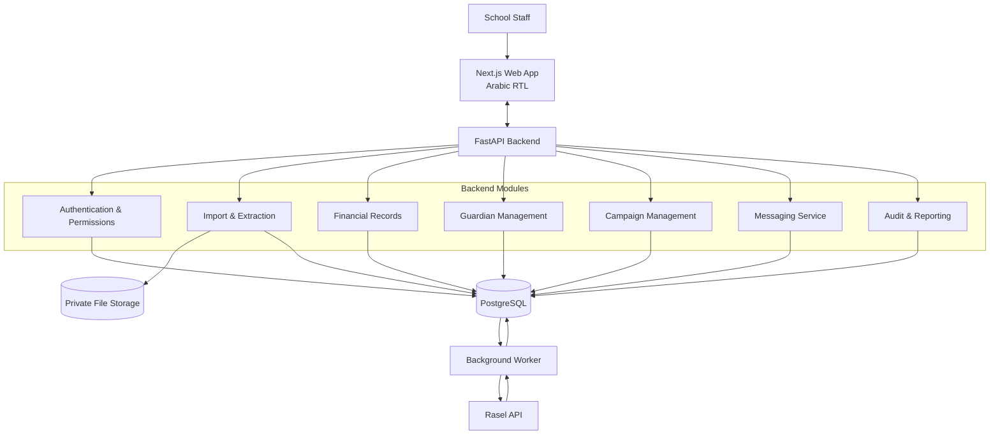

# FeeDesk
# Product Requirements Document (PRD)

**Version:** 1.0  
**Status:** Product baseline — ready for technical design and implementation planning  
**Product Type:** Private, single-school web application  
**Primary Market:** Syria  
**Primary Use Case:** School fee statement management and payment reminders  
**Messaging Provider:** Rasel  
**Primary Automated Channel:** SMS, subject to account and destination verification  
**Interface Language:** Arabic (RTL)  
**Document Language:** English  

---

# 1. Executive Summary

## 1.1 Product Overview

FeeDesk is a private web application designed for a single private school in Syria.

The application helps school administrative staff import existing fee statements, review outstanding balances, identify guardians who need payment reminders, prepare personalized messages, and send those messages through an integrated messaging provider.

The school currently maintains fee information in Excel and PDF files. These documents contain information such as:

- Guardian name.
- Guardian phone number.
- Amount paid.
- Remaining outstanding balance.
- Other fee-related details, depending on the source document.

The administrative team needs a straightforward way to process these statements and contact approximately 10–50 guardians without manually preparing and sending every reminder.

FeeDesk will transform this manual process into a controlled workflow:

**Import → Extract → Review → Validate → Prepare Campaign → Approve → Send → Track Results**

The application will integrate with Rasel through its API. Provider-specific functionality will remain isolated behind a messaging adapter so the application is not tightly coupled to a particular API implementation.

## 1.2 Product Positioning

FeeDesk is not a complete school management system.

It is a focused operational application that works with the school's existing financial statements without requiring the school to replace its current accounting or student management processes.

The application should provide a reliable administrative layer between existing fee records and communication with guardians.

## 1.3 Core Product Promise

A school employee should be able to upload a fee statement, review all outstanding balances, prepare a reminder campaign, approve it, and initiate the sending process from one simple interface.

The application must prioritize financial accuracy, operational clarity, and prevention of accidental messages.

## 1.4 Product Constraints

- The application serves one school only.
- The application is not intended to be a public SaaS product in Version 1.
- The expected campaign size is approximately 10–50 recipient phone numbers.
- Input documents are Excel and PDF files.
- Users are administrative employees, not technical operators.
- Rasel is the selected messaging provider.
- The final automated messaging channel must be verified against the school's actual Rasel account and Syrian recipient numbers.
- The system must not depend on AI to determine financial values or authorize sending.

---

# 2. Problem Statement

## 2.1 Current Situation

The school manages fee payments using existing statements.

Administrative employees need to determine which guardians still have outstanding balances and contact those guardians periodically.

The current workflow creates several operational problems:

1. Employees must inspect financial statements manually.
2. Identifying guardians with outstanding balances takes time.
3. Preparing individual reminders is repetitive.
4. Sending reminders one by one is inefficient.
5. Employees may accidentally contact guardians who have already paid.
6. It is difficult to maintain a reliable record of which reminders were prepared or sent.
7. There may be multiple students or fee entries associated with the same guardian.

## 2.2 Business Problem

The school needs a controlled way to convert existing financial statements into an actionable reminder campaign without introducing a full accounting system.

## 2.3 Proposed Solution

FeeDesk will provide:

- Structured statement import.
- Financial data extraction and review.
- Outstanding balance identification.
- Guardian/contact organization.
- Automated reminder generation.
- Human approval before sending.
- Rasel API integration.
- Message history and operational reporting.

---

# 3. Product Vision and Principles

## 3.1 Vision

Provide the school with a reliable and easy-to-use system for managing fee reminders while preserving the financial information and processes it already uses.

## 3.2 Product Principles

### P1. Simplicity First

The application must be understandable to non-technical administrative employees.

Users should not need to understand APIs, databases, integrations, background jobs, or technical workflows.

### P2. Financial Accuracy

Financial values must never be silently guessed, generated, or modified.

Every confirmed balance must have a traceable source.

### P3. Human Approval

The system may automate extraction, validation, filtering, and message preparation.

However, a human user must review the information and approve the campaign before it can be sent.

### P4. Operational Transparency

Users should always understand:

- Which records were imported.
- Which guardians have outstanding balances.
- Which records were excluded.
- Which messages were submitted.
- Which messages were confirmed as delivered, if that information is available.
- Which messages failed or have an unknown outcome.

### P5. Reliability Over Complexity

The system should use a simple architecture with strong transactional guarantees.

Do not introduce unnecessary infrastructure or distributed services.

### P6. No Unnecessary Features

Every feature must directly support fee statement management, reminder preparation, sending, or operational accountability.

---

# 4. Goals and Non-Goals

## 4.1 Primary Goals

| ID | Goal |
|---|---|
| G-01 | Import Excel and PDF fee statements. |
| G-02 | Extract relevant guardian and payment information. |
| G-03 | Allow employees to review and correct extracted information. |
| G-04 | Identify guardians with positive outstanding balances. |
| G-05 | Exclude zero-balance records from reminder campaigns. |
| G-06 | Prepare personalized fee reminder messages. |
| G-07 | Allow authorized staff to review and approve campaigns. |
| G-08 | Send approved messages through Rasel API. |
| G-09 | Track message submission and delivery outcomes where supported. |
| G-10 | Maintain an audit trail of important operations. |

## 4.2 Non-Goals

The following features are explicitly excluded from Version 1.

- Attendance management.
- Student enrollment.
- Teacher management.
- Class and timetable management.
- Examination and grading systems.
- General accounting or bookkeeping.
- Full invoicing and financial reconciliation.
- Online payment collection.
- Payment gateway integration.
- Parent mobile applications.
- Student mobile applications.
- Parent self-service portal.
- Multi-school tenancy.
- SaaS subscription management.
- AI chatbot.
- AI-generated financial calculations.
- Automated WhatsApp Web session management.
- Marketing automation.
- Complex business intelligence dashboards.

Any feature outside the defined scope requires a separate product decision.

---

# 5. Users and Roles

## 5.1 User Types

### A. Administrative Staff

Primary daily user.

Responsibilities:

- Upload fee statements.
- Review extracted records.
- Correct invalid information.
- Confirm imports.
- Create reminder campaigns.
- Review recipient lists.
- Preview messages.
- View campaign results.

### B. School Administrator

Responsible for system configuration and operational control.

Responsibilities:

- Manage staff accounts.
- Configure school information.
- Configure currency and message settings.
- Manage Rasel integration settings.
- Approve campaigns.
- Review activity logs.
- Monitor messaging operations.

## 5.2 Permission Matrix

| Permission | Staff | Administrator |
|---|---:|---:|
| Access dashboard | Yes | Yes |
| Upload statements | Yes | Yes |
| Review extracted records | Yes | Yes |
| Correct imported data | Yes | Yes |
| Confirm imports | Yes | Yes |
| View fee balances | Yes | Yes |
| Create campaigns | Yes | Yes |
| Edit draft campaigns | Yes | Yes |
| Preview messages | Yes | Yes |
| Approve campaigns | Configurable | Yes |
| Initiate approved campaigns | Configurable | Yes |
| View message history | Yes | Yes |
| Manage users | No | Yes |
| Configure provider credentials | No | Yes |
| Manage school settings | No | Yes |
| View complete audit log | No | Yes |

The backend must enforce all permissions. Hiding a button in the frontend is not a security control.

## 5.3 Approval Policy

The application must support configurable approval permissions.

Recommended initial policy:

- Staff prepare the campaign.
- Administrator reviews and approves it.
- The system records both the preparer and approver.

For a small school with only one authorized employee, the administrator may perform both actions. The audit log must still record the actual user.

---

# 6. Scope and Release Boundaries

## 6.1 Version 1 Scope

Version 1 includes:

1. Authentication and role-based access.
2. School settings.
3. Excel and PDF upload.
4. Document extraction.
5. Import review and correction.
6. Financial data validation.
7. Guardian/contact organization.
8. Outstanding balance filtering.
9. Reminder templates.
10. Campaign creation.
11. Message previews.
12. Campaign approval.
13. Rasel messaging integration.
14. Background message processing.
15. Message status tracking.
16. Campaign history.
17. Basic reporting.
18. Audit logging.
19. Backup and recovery procedures.

## 6.2 Future Enhancements

Potential future features, not required for the first production release:

- Scheduled campaigns.
- Additional messaging providers.
- Verified WhatsApp Business API support.
- Assisted WhatsApp manual messaging.
- CSV import.
- Additional report exports.
- Multiple fee periods and historical statement comparison.
- Advanced guardian record reconciliation.

These must not delay Version 1 unless a real operational requirement makes them necessary.

---

# 7. Core User Workflows

## 7.1 Workflow A — Import a Fee Statement

**Objective:** Convert a school statement into reviewable financial records.

Steps:

1. User signs in.
2. User opens Fee Statements.
3. User selects Upload Statement.
4. User chooses an Excel or PDF file.
5. The backend validates the file.
6. The system creates an import batch.
7. The extraction process begins.
8. The system identifies available columns and fields.
9. Extracted records appear in a staging table.
10. The system displays warnings and validation errors.
11. User reviews and corrects the records.
12. User confirms the import.
13. Confirmed records become eligible for reminder campaigns.

Important:

Uploading a file must not automatically create sendable financial records.

Every import must pass through the review and confirmation stage.

## 7.2 Workflow B — Review Financial Records

**Objective:** Ensure that the imported information is correct.

The review interface should display:

- Guardian name.
- Guardian phone number.
- Student name or reference, if available.
- Amount paid.
- Remaining balance.
- Currency.
- Fee period, if available.
- Validation status.
- Source reference.

Users should be able to correct fields directly in the review interface.

The application must clearly distinguish between:

- Valid records.
- Records requiring review.
- Invalid records.
- Duplicate records.
- Records excluded from reminders.

## 7.3 Workflow C — Create a Reminder Campaign

**Objective:** Prepare reminders for eligible guardians.

Steps:

1. User opens Campaigns.
2. User selects Create Campaign.
3. User chooses the relevant fee statement or confirmed records.
4. The system identifies eligible outstanding balances.
5. The system groups related fee entries by guardian.
6. The system excludes zero-balance records.
7. The system checks phone numbers and currencies.
8. The system generates personalized messages.
9. User reviews the campaign summary.
10. User previews individual messages.
11. User submits the campaign for approval.

## 7.4 Workflow D — Approve and Send

**Objective:** Send only reviewed and approved reminders.

Steps:

1. Authorized user opens a campaign awaiting approval.
2. User reviews the recipient count.
3. User reviews the total outstanding amount by currency.
4. User reviews excluded records and warnings.
5. User inspects message previews.
6. User approves the campaign.
7. The system freezes the campaign snapshot.
8. The backend creates durable send jobs.
9. The background worker processes the jobs.
10. Each message is submitted to Rasel.
11. The application records provider responses.
12. The campaign results become visible.

A campaign must never be sent directly from a browser click through a frontend API call to Rasel.

The frontend communicates with FeeDesk's backend. The backend controls sending.

## 7.5 Workflow E — Review Results

Users should be able to open a completed or partially completed campaign and inspect:

- Total recipients.
- Submitted messages.
- Provider-accepted messages.
- Confirmed delivered messages, when available.
- Failed messages.
- Unknown outcomes.
- Excluded recipients.
- Estimated or actual message costs, if the provider returns them.

The interface must not display a message as delivered merely because the provider accepted the API request.

---

# 8. Functional Requirements

Priority definitions:

- **P0:** Mandatory for initial production release.
- **P1:** Important, but not required to launch the first controlled pilot.
- **P2:** Future enhancement.

## 8.1 Authentication and User Management

| ID | Requirement | Priority |
|---|---|---|
| FR-AUTH-01 | Users must authenticate before accessing the application. | P0 |
| FR-AUTH-02 | The system must support Administrator and Staff roles. | P0 |
| FR-AUTH-03 | Backend endpoints must enforce permissions. | P0 |
| FR-AUTH-04 | Inactive users must not be able to authenticate. | P0 |
| FR-AUTH-05 | User creation and role changes must be recorded in the audit log. | P0 |
| FR-AUTH-06 | Passwords must be securely hashed. | P0 |
| FR-AUTH-07 | Session expiration and logout must be supported. | P0 |
| FR-AUTH-08 | Password reset must be available to the administrator or through a secure recovery process. | P1 |
| FR-AUTH-09 | Multi-factor authentication may be introduced if required by the school's security policy. | P2 |

## 8.2 School Configuration

| ID | Requirement | Priority |
|---|---|---|
| FR-SCH-01 | The system must store the school's official name. | P0 |
| FR-SCH-02 | The system must support configurable currency. | P0 |
| FR-SCH-03 | The system must support configurable locale and timezone. | P0 |
| FR-SCH-04 | The system must support school contact details. | P0 |
| FR-SCH-05 | The system must support editable reminder templates. | P0 |
| FR-SCH-06 | Provider configuration must be accessible only to administrators. | P0 |
| FR-SCH-07 | The application must support configurable campaign batch and sending limits. | P0 |
| FR-SCH-08 | Important configuration changes must be audited. | P0 |

The application must not hardcode a particular currency or assume every statement uses USD.

## 8.3 File Upload and Import

### Supported Formats

Version 1 supports:

- `.xlsx`
- PDF

CSV may be considered later but is not required for the initial release.

Image-only files and standalone photographs are outside the initial import scope.

### Requirements

| ID | Requirement | Priority |
|---|---|---|
| FR-IMP-01 | Users must be able to upload Excel and PDF statements. | P0 |
| FR-IMP-02 | Unsupported file formats must be rejected. | P0 |
| FR-IMP-03 | File size and processing limits must be configurable. | P0 |
| FR-IMP-04 | Files must be validated before processing. | P0 |
| FR-IMP-05 | The system must create a separate import batch for every upload. | P0 |
| FR-IMP-06 | Excel worksheets must be inspectable and selectable when multiple sheets exist. | P0 |
| FR-IMP-07 | The system must detect available headers and suggest column mappings. | P0 |
| FR-IMP-08 | Users must be able to manually map source columns. | P0 |
| FR-IMP-09 | PDF text and tables must be extracted where the source document permits it. | P0 |
| FR-IMP-10 | Scanned PDFs must be detected and identified as requiring OCR or manual handling. | P0 |
| FR-IMP-11 | OCR-derived financial values must require human verification. | P0 |
| FR-IMP-12 | Each extracted record must retain a source row or page reference where possible. | P0 |
| FR-IMP-13 | Users must be able to review extracted records before confirmation. | P0 |
| FR-IMP-14 | Users must be able to correct extracted information. | P0 |
| FR-IMP-15 | The same file must not be imported twice without explicit duplicate-resolution handling. | P0 |
| FR-IMP-16 | Import history must be available. | P0 |
| FR-IMP-17 | Recurring column mappings may be saved as profiles. | P1 |

### Minimum Data Fields

The system must support the following fields:

| Field | Requirement |
|---|---|
| Guardian name | Required for a sendable recipient |
| Guardian phone | Required for a sendable recipient |
| Remaining balance | Required for a sendable fee record |
| Currency | Required |
| Amount paid | Supported; expected where provided by the statement |
| Total fee | Optional |
| Student name/reference | Optional |
| Fee period | Optional |
| Source filename | Required as import metadata |
| Source row/page | Required where technically available |
| Additional source fields | May be preserved as reference data when useful |

A record missing a phone number may still be retained as a financial record, but it cannot be included in an automated messaging campaign.

### Import States

Each import batch must support:

- `uploaded`
- `processing`
- `review_required`
- `ready_to_confirm`
- `confirmed`
- `failed`
- `cancelled`

The application must display a human-readable explanation for any failed or blocked import.

## 8.4 Financial Data Management

This is a critical module.

### Financial Principles

1. The application must preserve source financial values.
2. The application must not silently calculate or replace outstanding balances.
3. All money values must use fixed-precision decimal storage.
4. Currency must be explicit.
5. Financial inconsistencies must be flagged for review.
6. Only reviewed records may be used in campaigns.

### Requirements

| ID | Requirement | Priority |
|---|---|---|
| FR-FIN-01 | Store monetary values using database decimal/numeric types. | P0 |
| FR-FIN-02 | Never use binary floating-point as the source of truth for money. | P0 |
| FR-FIN-03 | Every financial amount must have a currency. | P0 |
| FR-FIN-04 | Preserve the source remaining balance. | P0 |
| FR-FIN-05 | Do not invent a total fee when it is absent. | P0 |
| FR-FIN-06 | If total fee and paid amount are available, calculate a comparison value for validation. | P0 |
| FR-FIN-07 | Do not automatically overwrite the source remaining balance with a calculated value. | P0 |
| FR-FIN-08 | Flag negative balances for manual review. | P0 |
| FR-FIN-09 | Flag inconsistent totals. | P0 |
| FR-FIN-10 | Exclude zero-balance records from campaigns. | P0 |
| FR-FIN-11 | Block unreviewed financial records from campaigns. | P0 |
| FR-FIN-12 | Preserve prior values when a user corrects a financial record. | P0 |
| FR-FIN-13 | Maintain source provenance for every confirmed fee record. | P0 |
| FR-FIN-14 | Support multiple fee entries for the same guardian. | P0 |
| FR-FIN-15 | Support optional student associations without requiring student data in every statement. | P0 |

### Balance Logic

If the statement provides a remaining balance:

`Confirmed Remaining Balance = Reviewed Source Remaining Balance`

If the statement provides total fee and amount paid:

`Calculated Remaining Balance = Total Fee - Amount Paid`

The calculated value is used as a validation comparison.

It must not automatically replace the source value.

If the two values differ, the system must display a discrepancy and require the user to review it.

If the statement does not provide total fee, the system must not invent it.

### Zero-Balance Rule

A record with a confirmed remaining balance equal to zero:

- Remains in the system.
- Is marked as paid or no outstanding balance, depending on the school's terminology.
- Is excluded from reminder campaigns by default.
- Must not receive an outstanding-balance reminder.

### Currency Rule

The system must never combine balances in different currencies into one total.

For example:

- 100 USD.
- 500,000 SYP.

These values must remain separate in campaign summaries and message content.

## 8.5 Guardian and Contact Management

FeeDesk must not assume that every imported row represents a unique guardian.

A guardian may have multiple fee records or multiple students associated with the same contact.

### Requirements

| ID | Requirement | Priority |
|---|---|---|
| FR-GRD-01 | The system must maintain guardian/contact records. | P0 |
| FR-GRD-02 | A guardian may be associated with multiple fee records. | P0 |
| FR-GRD-03 | Student information must be optional when unavailable in the source. | P0 |
| FR-GRD-04 | Phone numbers must be normalized to international E.164 format where possible. | P0 |
| FR-GRD-05 | Original source phone values must be preserved. | P0 |
| FR-GRD-06 | Invalid or ambiguous phone numbers must be flagged. | P0 |
| FR-GRD-07 | Duplicate guardian candidates must be identified for review. | P0 |
| FR-GRD-08 | The system must not merge guardians solely because they share a phone number. | P0 |
| FR-GRD-09 | The system must support manual guardian identity resolution. | P0 |
| FR-GRD-10 | A guardian's contact information must be changeable by authorized staff. | P0 |

### Guardian Grouping Rules

The system may consolidate multiple fee entries into one reminder when the records are confidently associated with the same guardian and the same destination phone number.

The grouping process must preserve individual fee-line details internally.

Different currencies must never be combined.

Two different guardian identities sharing a phone number must be flagged rather than automatically merged.

## 8.6 Outstanding Balance Eligibility

The system must identify records that are eligible for reminders.

A fee record is eligible only when all of the following conditions are met:

1. The financial record is confirmed.
2. The remaining balance is greater than zero.
3. The currency is known.
4. The guardian/contact association is valid.
5. The destination phone is valid.
6. The record is not excluded or blocked.
7. The record is not already included in the same campaign.
8. The record satisfies any school-defined communication restrictions.

The system must show why a record was excluded.

## 8.7 Campaign Management

### Campaign Creation

| ID | Requirement | Priority |
|---|---|---|
| FR-CAM-01 | Users must be able to create a reminder campaign. | P0 |
| FR-CAM-02 | Campaigns must be generated from confirmed financial records. | P0 |
| FR-CAM-03 | Users must be able to select a statement, period, or eligible record set. | P0 |
| FR-CAM-04 | The system must automatically exclude zero balances. | P0 |
| FR-CAM-05 | The system must group related records by guardian. | P0 |
| FR-CAM-06 | Users must see the campaign recipient count. | P0 |
| FR-CAM-07 | Users must see total outstanding amounts grouped by currency. | P0 |
| FR-CAM-08 | Users must see excluded recipients and exclusion reasons. | P0 |
| FR-CAM-09 | Users must be able to review individual recipients. | P0 |
| FR-CAM-10 | The system must support draft campaigns. | P0 |
| FR-CAM-11 | The system must support campaign cancellation. | P0 |

### Campaign Preview

Before approval, the system must display:

- Guardian name.
- Destination phone number.
- Associated student names or references, if available.
- Relevant fee period, if available.
- Outstanding amount.
- Currency.
- Final rendered message.
- Channel.
- Validation status.

Users must be able to inspect every recipient message before approval.

### Campaign Approval

| ID | Requirement | Priority |
|---|---|---|
| FR-CAM-12 | Campaign approval must require explicit user action. | P0 |
| FR-CAM-13 | The approver must be recorded. | P0 |
| FR-CAM-14 | The system must freeze the approved campaign data. | P0 |
| FR-CAM-15 | The snapshot must include recipient, phone, balance, currency, message text, channel, and template version. | P0 |
| FR-CAM-16 | Changes to an approved campaign must require cancellation/revocation and a new version. | P0 |
| FR-CAM-17 | The system must prevent sending a draft or unapproved campaign. | P0 |
| FR-CAM-18 | Campaign approval and send-job creation must be transactionally safe. | P0 |

### Campaign States

The following lifecycle should be supported:

- `draft`
- `review_required`
- `awaiting_approval`
- `approved`
- `queued`
- `sending`
- `completed`
- `completed_with_errors`
- `failed`
- `cancelled`

State transitions must be validated by the backend.

The frontend must not be able to force a campaign into a state that violates the lifecycle rules.

## 8.8 Message Templates

### Requirements

- Administrators must be able to manage reminder templates.
- Templates must support Arabic text.
- Templates must support approved variables.
- Template versions must be retained.
- Campaign snapshots must preserve the exact rendered message.
- Unresolved variables must block approval.
- The system must provide message previews before sending.

### Initial Supported Variables

| Variable | Description |
|---|---|
| `{{guardian_name}}` | Guardian's name |
| `{{school_name}}` | School name |
| `{{student_name}}` | Student name, when available |
| `{{student_list}}` | Associated student names, when available |
| `{{amount}}` | Outstanding amount |
| `{{currency}}` | Currency |
| `{{fee_period}}` | Fee period, when available |
| `{{school_contact}}` | School contact information |

Variables that depend on optional data must have explicit fallback behavior.

For example, a template must not display an empty student name if the source document does not contain student information.

### Initial Message Template

Draft English example:

> Dear {{guardian_name}}, this is a payment reminder from {{school_name}}. An outstanding school-fee balance of {{amount}} {{currency}} remains for {{fee_period}}. Please contact the school administration if you have already paid or need clarification.

The final Arabic wording must be approved by the school before production.

The application must not expose unnecessary personal or student information in a short SMS.

## 8.9 Rasel Messaging Integration

### Integration Objective

Rasel is the selected messaging provider for FeeDesk.

The integration must allow the application to submit approved reminders and record the provider response.

The provider implementation must be isolated behind an internal adapter.

### Integration Requirements

| ID | Requirement | Priority |
|---|---|---|
| FR-RAS-01 | Rasel must be the initial configured provider. | P0 |
| FR-RAS-02 | Rasel API calls must originate from the backend. | P0 |
| FR-RAS-03 | API credentials must never be exposed to the frontend. | P0 |
| FR-RAS-04 | The integration must use the API version and contract confirmed for the school's account. | P0 |
| FR-RAS-05 | SMS must be available as the initial automated channel only after account and destination testing. | P0 |
| FR-RAS-06 | The configured channel must be explicit in each approved campaign. | P0 |
| FR-RAS-07 | The system must record Rasel request and tracking identifiers when returned. | P0 |
| FR-RAS-08 | Provider acceptance and confirmed delivery must be separate states. | P0 |
| FR-RAS-09 | The system must handle partial failures. | P0 |
| FR-RAS-10 | The system must respect provider rate limits. | P0 |
| FR-RAS-11 | The system must respect provider balance and quota limits. | P0 |
| FR-RAS-12 | The system must use idempotency keys where supported by the account and endpoint. | P0 |
| FR-RAS-13 | Ambiguous timeouts must not trigger blind resends. | P0 |
| FR-RAS-14 | Provider errors must be translated into understandable messages for staff. | P0 |
| FR-RAS-15 | Administrators must be able to run a controlled test message. | P0 |
| FR-RAS-16 | WhatsApp official sending to Syrian numbers must remain disabled until verified. | P0 |
| FR-RAS-17 | The system must retain provider-specific details for troubleshooting without exposing secrets. | P0 |

### API Contract Baseline

The currently published Rasel documentation identifies:

- Base URL: `https://raselsms.com`
- Authentication header: `X-API-Key`
- Unified message endpoint: `POST /api/v2/messages/send`
- Local SMS channel identifier: `local_sms`
- International phone-number format: E.164
- Recipient field: `to`
- Message content: `content.text`
- Optional idempotency header: `Idempotency-Key`

The published documentation also describes batch submission with up to 100 recipients when the same message content applies to the entire batch.

**Important implementation constraint:** FeeDesk generates personalized messages. A batch request that applies one shared message body to every recipient must not be used to send different guardian names or balances. The initial implementation should create one durable message job per personalized recipient and submit each personalized message individually, unless Rasel confirms a per-recipient personalized batch contract.

The integration must be tested against the school's actual Rasel account before production. Published examples do not replace account-level verification.

### Channel Policy

**Initial channel: SMS**

The initial production configuration should use an explicitly selected local SMS route after verification of:

- Syrian destination coverage.
- School sender identity.
- Fee-reminder use-case permission.
- Pricing and balance behavior.
- Rate limits.
- Message encoding and segment calculation.
- Delivery reporting capabilities.

**WhatsApp: conditional future capability**

WhatsApp official API must not be enabled for Syrian `+963` recipients merely because the API accepts a request.

It requires:

1. Confirmation from Rasel that the school account can send to the relevant Syrian numbers.
2. Confirmation of the official sender setup.
3. Approval of any required WhatsApp templates.
4. A controlled end-to-end test.
5. Verification of provider status behavior.

No silent channel fallback is allowed. If the campaign is configured for SMS, the system must not automatically switch recipients to WhatsApp.

### Message Delivery States

The application must distinguish:

| Internal State | Meaning |
|---|---|
| `pending` | Message exists but has not been submitted. |
| `submitting` | Worker is submitting the message. |
| `provider_accepted` | Provider accepted the request. |
| `queued_by_provider` | Provider reports that the message is queued. |
| `delivered` | Delivery is explicitly confirmed by a reliable provider status. |
| `failed` | Provider or delivery system reported failure. |
| `unknown` | Submission outcome cannot currently be determined. |
| `cancelled` | Message was cancelled before submission. |

Provider response values must be mapped to these internal states only after their exact meaning is confirmed.

A provider response such as `sent` must not automatically be interpreted as delivery to the recipient's device.

### Retry Policy

- Permanent validation errors must not be retried.
- Insufficient balance requires administrator action.
- Rate-limit responses may be retried according to the provider's documented retry information.
- Temporary provider failures may be retried when safe.
- Unknown outcomes require reconciliation before another submission.
- Every retry must preserve the internal message identity and idempotency key where supported.

### SMS Encoding and Cost

Arabic messages may use Unicode SMS encoding and may be split into multiple billable segments.

FeeDesk must not assume that one message always equals one SMS segment.

Before production, the integration must verify how Rasel calculates Arabic message length, concatenated segments, and cost.

The application should display an estimated message cost or segment count only when it can calculate it reliably from documented provider rules or a verified provider quote.

## 8.10 Background Processing

Message sending must be handled by a background worker.

Requirements:

- Approved campaigns create durable send jobs.
- Jobs are stored in PostgreSQL.
- The worker claims jobs safely.
- A worker restart must not lose pending jobs.
- The worker must not process the same message twice concurrently.
- Each message must have a stable internal identifier.
- Sending must respect configurable concurrency and pacing.
- Failed jobs must retain diagnostic information.
- Unknown jobs must be held for reconciliation.
- Campaign status must be derived from recipient message outcomes.

For the expected school workload, a PostgreSQL-backed worker is sufficient for Version 1. Redis, Kubernetes, and a distributed task-processing platform are not required by default.

## 8.11 Audit Log and History

The system must record:

- User login events where appropriate.
- File uploads.
- Import processing events.
- Import confirmations.
- Financial corrections.
- Guardian/contact changes.
- Campaign creation.
- Campaign edits.
- Campaign approval.
- Campaign cancellation.
- Message submissions.
- Provider responses.
- Delivery-status updates.
- Retry operations.
- Provider configuration changes.
- User and permission changes.

Audit events must include:

- Actor.
- Timestamp.
- Action.
- Entity type.
- Entity identifier.
- Relevant before/after values where appropriate.
- Related import or campaign identifier.

Sensitive information must not be unnecessarily copied into logs.

## 8.12 Dashboard and Reporting

The dashboard should answer operational questions, not serve as a decorative analytics page.

It should display:

- Number of outstanding fee records.
- Total outstanding amount grouped by currency.
- Number of recently imported statements.
- Imports awaiting review.
- Campaigns awaiting approval.
- Active or recently completed campaigns.
- Recent messaging failures.
- Rasel integration health.

Reports should include:

- Import summary.
- Eligible recipient count.
- Excluded record count.
- Outstanding totals by currency.
- Submitted message count.
- Confirmed delivery count, if available.
- Failed and unknown message count.
- Campaign completion time.

Export to XLSX or CSV may be added as a P1 requirement if the school needs downloadable reports.

---

# 9. Business Rules

These rules are mandatory and must be enforced on the backend.

| ID | Business Rule |
|---|---|
| BR-01 | Only confirmed financial records can enter campaigns. |
| BR-02 | A zero outstanding balance is not eligible for a reminder. |
| BR-03 | Unreviewed or invalid balances must never be sent. |
| BR-04 | The source remaining balance is preserved after human review. |
| BR-05 | Calculated balances are validation comparisons, not silent replacements. |
| BR-06 | Missing total fee values must never be invented. |
| BR-07 | Every monetary value must have a currency. |
| BR-08 | Different currencies must never be combined. |
| BR-09 | Multiple fee lines may belong to the same guardian. |
| BR-10 | Student data is optional when absent from source statements. |
| BR-11 | A phone number alone is not sufficient to merge different guardian identities. |
| BR-12 | A campaign must be approved before sending. |
| BR-13 | Approved campaign snapshots are immutable. |
| BR-14 | A campaign modification after approval requires a new approval lifecycle. |
| BR-15 | Every recipient message must have an internal unique identifier. |
| BR-16 | A retry must not create an accidental duplicate message. |
| BR-17 | Provider acceptance is not equivalent to confirmed delivery. |
| BR-18 | Failed or unknown outcomes must remain visible to the user. |
| BR-19 | No automatic channel switching is allowed. |
| BR-20 | The school must authorize the communication process and message content. |

---

# 10. Logical Data Model

The final database schema will be defined during technical design. The following entities describe the required logical structure.

## 10.1 Core Entities

### `users`

Stores application users.

Suggested fields:

- `id`
- `name`
- `email_or_username`
- `password_hash`
- `role`
- `is_active`
- `last_login_at`
- `created_at`
- `updated_at`

### `school_settings`

Stores the single school's configuration.

Suggested fields:

- `id`
- `school_name`
- `default_currency`
- `timezone`
- `locale`
- `contact_phone`
- `contact_email`
- `created_at`
- `updated_at`

### `import_batches`

Represents one import operation.

Suggested fields:

- `id`
- `source_filename`
- `file_hash`
- `file_type`
- `uploaded_by`
- `status`
- `worksheet_name`
- `total_rows`
- `valid_rows`
- `invalid_rows`
- `duplicate_rows`
- `created_at`
- `confirmed_at`

### `source_files`

Stores private file metadata.

Suggested fields:

- `id`
- `import_batch_id`
- `storage_key`
- `original_filename`
- `content_type`
- `file_size`
- `sha256_hash`
- `uploaded_by`
- `created_at`
- `retention_until`

### `staged_rows`

Stores extracted records before confirmation.

Suggested fields:

- `id`
- `import_batch_id`
- `source_row_number`
- `source_page_number`
- `raw_data`
- `normalized_data`
- `validation_status`
- `validation_errors`
- `reviewed_by`
- `reviewed_at`

### `guardians`

Stores guardian/contact identities.

Suggested fields:

- `id`
- `full_name`
- `normalized_name`
- `status`
- `created_at`
- `updated_at`

### `guardian_contacts`

Stores contact methods.

Suggested fields:

- `id`
- `guardian_id`
- `original_phone`
- `normalized_phone`
- `contact_type`
- `is_primary`
- `is_verified`
- `created_at`
- `updated_at`

### `students`

Optional student records.

Suggested fields:

- `id`
- `student_reference`
- `full_name`
- `status`
- `created_at`
- `updated_at`

The system must not require this table to be populated for every fee record.

### `guardian_student_relationships`

Preserves associations between guardians and students where known.

Suggested fields:

- `id`
- `guardian_id`
- `student_id`
- `relationship_type`
- `source_import_id`
- `created_at`

### `fee_balances`

Stores confirmed fee records.

Suggested fields:

- `id`
- `guardian_id`
- `student_id` (nullable)
- `import_batch_id`
- `source_row_id`
- `fee_period`
- `total_fee`
- `amount_paid`
- `remaining_balance`
- `currency`
- `record_status`
- `reviewed_by`
- `reviewed_at`
- `created_at`
- `updated_at`

### `message_templates`

Stores message templates.

Suggested fields:

- `id`
- `name`
- `language`
- `channel`
- `template_body`
- `version`
- `is_active`
- `created_by`
- `created_at`
- `updated_at`

### `campaigns`

Stores campaign lifecycle information.

Suggested fields:

- `id`
- `name`
- `source_import_id`
- `status`
- `channel`
- `template_id`
- `template_version`
- `created_by`
- `approved_by`
- `approved_at`
- `snapshot_hash`
- `created_at`
- `updated_at`

### `campaign_recipients`

Stores immutable recipient snapshots.

Suggested fields:

- `id`
- `campaign_id`
- `guardian_id`
- `destination_phone_snapshot`
- `guardian_name_snapshot`
- `amount_snapshot`
- `currency_snapshot`
- `fee_details_snapshot`
- `message_body_snapshot`
- `eligibility_status`
- `created_at`

### `messages`

Stores individual message lifecycle information.

Suggested fields:

- `id`
- `campaign_id`
- `campaign_recipient_id`
- `provider`
- `channel`
- `internal_status`
- `provider_status`
- `provider_request_id`
- `provider_message_id`
- `idempotency_key`
- `submitted_at`
- `delivered_at`
- `failed_at`
- `last_error_code`
- `last_error_summary`
- `created_at`
- `updated_at`

### `send_jobs`

Stores background processing tasks.

Suggested fields:

- `id`
- `message_id`
- `status`
- `attempt_count`
- `next_attempt_at`
- `locked_at`
- `locked_by`
- `last_error`
- `created_at`
- `updated_at`

### `provider_events`

Stores incoming provider status events where available.

Suggested fields:

- `id`
- `provider`
- `provider_event_id`
- `provider_message_id`
- `event_type`
- `event_payload_redacted`
- `received_at`
- `processed_at`

### `audit_events`

Stores operational history.

Suggested fields:

- `id`
- `actor_user_id`
- `action`
- `entity_type`
- `entity_id`
- `before_data`
- `after_data`
- `ip_address` (subject to privacy policy)
- `created_at`

## 10.2 Data Integrity Requirements

- Use foreign keys for relevant relationships.
- Use unique constraints to prevent duplicate internal message jobs.
- Use unique import file hashes within the appropriate import policy.
- Preserve original source values.
- Preserve campaign snapshots.
- Do not use hard deletion for approved campaign history.
- Apply controlled retention policies to uploaded documents.
- Use database transactions for import confirmation and campaign approval.

---

# 11. Campaign Snapshot and Message Reliability

This section is critical to prevent financial and messaging inconsistencies.

## 11.1 Immutable Approval Snapshot

At approval time, the system must create a fixed snapshot containing:

- Campaign identity.
- Approved recipients.
- Destination phone numbers.
- Guardian names.
- Fee record references.
- Approved balances.
- Currency.
- Rendered message body.
- Messaging channel.
- Template identifier and version.
- Approval user and timestamp.

The snapshot must not change if a guardian's phone number or fee balance is edited later.

## 11.2 Snapshot Integrity

The system should generate a deterministic hash of the approved campaign content.

The hash can be used to verify that the approved data has not changed before the sending process starts.

## 11.3 Durable Job Creation

Campaign approval and send-job creation must happen in one database transaction.

The transaction should:

1. Validate that the campaign is eligible for approval.
2. Freeze the snapshot.
3. Record the approver.
4. Create one message record per recipient.
5. Create corresponding durable send jobs.
6. Set the campaign state to approved or queued.

If the transaction fails, the application must not leave a partially approved campaign.

## 11.4 Idempotency

The internal application must have its own permanent message identity.

The Rasel adapter should use the provider's idempotency mechanism where available and enabled.

A stable key should be generated per individual message submission.

Replaying the same job must not create a second logical message.

If Rasel does not confirm the result of a submission, the message must enter an unknown state. It must not be blindly submitted again.

---

# 12. Application Architecture

## 12.1 Architectural Style

**Modular Monolith**

The system should be built as a modular monolith with a separate background worker process using the same backend codebase.

This architecture provides:

- Clear module separation.
- Simple deployment.
- Transactional database operations.
- Low operational complexity.
- Easier maintenance.
- Sufficient capacity for the expected school workload.

Microservices are not justified for Version 1.

## 12.2 Proposed Technology Stack

| Layer | Recommended Technology | Responsibility |
|---|---|---|
| Frontend | Next.js + TypeScript | Web application and user interface |
| Backend | Python + FastAPI | Application logic and API |
| Database | PostgreSQL | Persistent operational data |
| Excel processing | openpyxl | XLSX extraction |
| PDF processing | pdfplumber or equivalent | Text and table extraction |
| OCR fallback | Tesseract or selected OCR service | Assisted scanned-PDF extraction |
| Background worker | Python worker + PostgreSQL queue tables | Durable message processing |
| File storage | Private local or object storage | Original statement files |
| Testing | Pytest + Playwright | Backend and end-to-end testing |

These are implementation recommendations. Final deployment and storage choices should be confirmed against the school's hosting and data requirements.

## 12.3 High-Level Component Diagram



## 12.4 Backend Modules

The backend should have clear internal boundaries.

### `identity`

- Authentication.
- Users.
- Sessions.
- Roles.
- Permissions.

### `school`

- School profile.
- Locale.
- Currency.
- Operational settings.

### `imports`

- Upload handling.
- File validation.
- XLSX extraction.
- PDF extraction.
- OCR orchestration if required.
- Column mapping.
- Staging records.
- Import confirmation.

### `finance`

- Fee records.
- Balance validation.
- Financial eligibility.
- Currency handling.
- Financial corrections.

### `guardians`

- Guardian identities.
- Phone normalization.
- Contact resolution.
- Guardian/student associations.

### `campaigns`

- Campaign creation.
- Recipient selection.
- Grouping.
- Message preview.
- Approval.
- Immutable snapshots.

### `messaging`

- Message templates.
- Provider abstraction.
- Rasel adapter.
- Message state mapping.

### `operations`

- Send jobs.
- Worker execution.
- Retry policy.
- Reconciliation.
- Provider callbacks where supported.

### `audit`

- Operational events.
- Change history.
- Administrative activity.

### `reports`

- Dashboard summaries.
- Import reports.
- Campaign reports.
- Message outcomes.

---

# 13. Frontend and UX Requirements

## 13.1 UX Strategy

The interface is intended for administrative employees.

It must not look or behave like a developer tool.

The primary experience should be a straightforward operational application.

Design principles:

- Arabic-first.
- Proper right-to-left layout.
- Desktop-first responsive design.
- Clear typography.
- Minimal navigation.
- Simple tables.
- Clear status labels.
- No unnecessary graphs.
- No excessive cards.
- No distracting gradients.
- No decorative AI visuals.
- Clear confirmation before important actions.
- Helpful errors written in normal language.

The application should use a professional, calm visual language appropriate for a private educational institution.

## 13.2 Navigation Structure

The initial navigation should contain:

1. Home.
2. Fee Statements.
3. Campaigns.
4. Message History.
5. Audit Log.
6. Settings.

Guardians and fee records should initially be accessible through contextual views rather than separate complicated navigation sections.

A dedicated guardian-management page should only be added if real usage demonstrates the need.

## 13.3 Screen Requirements

### A. Home Dashboard

Purpose: Show what requires attention.

Components:

- Outstanding fee summary.
- Imports awaiting review.
- Campaigns awaiting approval.
- Recent campaigns.
- Recent failed messages.
- Rasel connection status.

The dashboard must prioritize actionable items.

It must not contain charts that do not help the employee complete a task.

### B. Fee Statements

Purpose: Manage uploaded files.

Components:

- Upload Statement button.
- Supported formats.
- Import history.
- Import date.
- Uploaded filename.
- Imported by.
- Number of rows.
- Import status.
- Review action.
- Error summary.

The upload process must show clear progress.

### C. Import Review

Purpose: Validate extracted information.

The main interface should provide a table.

Suggested columns:

- Guardian.
- Phone.
- Student/reference.
- Paid.
- Remaining.
- Currency.
- Validation.
- Source.

Users should be able to:

- Edit values.
- Correct phone numbers.
- Review warnings.
- Resolve duplicates.
- Exclude invalid records.
- Confirm the import.

Errors must appear next to the affected record.

### D. Campaigns

Purpose: Manage reminder campaigns.

Tabs or filters:

- Draft.
- Awaiting Approval.
- Approved.
- Sending.
- Completed.
- Failed/Partial.

A campaign list should show:

- Campaign name.
- Created date.
- Recipient count.
- Total amount by currency.
- Status.
- Created by.
- Approved by.

### E. Campaign Review and Preview

Purpose: Give the user confidence before sending.

The page should show:

**Campaign Summary**
- Number of recipients.
- Total outstanding amount by currency.
- Excluded count.
- Invalid contact count.
- Selected channel.
- Estimated cost, when available.

**Recipient Table**
- Guardian.
- Phone.
- Amount.
- Currency.
- Message preview.
- Validation status.

Users must be able to open an individual message preview.

Approval must be an explicit action.

### F. Campaign Results

Purpose: Show what happened after approval.

Show:

- Campaign progress.
- Submitted messages.
- Provider-accepted messages.
- Delivered messages when confirmed.
- Failed messages.
- Unknown outcomes.
- Per-recipient details.
- Provider reference where appropriate.

The interface must explain the difference between provider acceptance and actual delivery.

### G. Message History

Purpose: Search and inspect previous messages.

Search filters:

- Guardian.
- Phone number.
- Campaign.
- Date.
- Message state.
- Channel.

A message detail view should show:

- Original campaign reference.
- Approved message body.
- Destination.
- Submission timestamp.
- Provider response.
- Delivery events, if available.
- Retry history.

### H. Settings

Settings should include:

- School profile.
- Currency and locale.
- Message templates.
- Staff accounts.
- Rasel configuration.
- Sender identity.
- Operational limits.

Sensitive provider credentials must not be displayed after saving.

---

# 14. Internal API Requirements

The application must expose a versioned internal API.

The following routes are a proposed baseline. Exact naming may be adjusted during implementation while preserving the resource boundaries.

| Method | Route | Purpose |
|---|---|---|
| POST | `/api/v1/auth/login` | Authenticate a user |
| POST | `/api/v1/auth/logout` | End a session |
| GET | `/api/v1/auth/me` | Read current user |
| GET | `/api/v1/dashboard` | Dashboard summary |
| POST | `/api/v1/imports` | Upload a statement |
| GET | `/api/v1/imports` | List imports |
| GET | `/api/v1/imports/{id}` | Import details |
| GET | `/api/v1/imports/{id}/rows` | Staged rows |
| PATCH | `/api/v1/imports/{id}/rows/{row_id}` | Correct staged row |
| POST | `/api/v1/imports/{id}/confirm` | Confirm import |
| POST | `/api/v1/imports/{id}/cancel` | Cancel import |
| GET | `/api/v1/fee-balances` | Search fee records |
| GET | `/api/v1/guardians` | Search guardians |
| GET | `/api/v1/guardians/{id}` | Guardian details |
| POST | `/api/v1/campaigns` | Create campaign draft |
| GET | `/api/v1/campaigns` | List campaigns |
| GET | `/api/v1/campaigns/{id}` | Campaign details |
| GET | `/api/v1/campaigns/{id}/preview` | Preview campaign |
| POST | `/api/v1/campaigns/{id}/submit-review` | Submit campaign for approval |
| POST | `/api/v1/campaigns/{id}/approve` | Approve campaign |
| POST | `/api/v1/campaigns/{id}/cancel` | Cancel campaign |
| GET | `/api/v1/campaigns/{id}/results` | Campaign results |
| GET | `/api/v1/messages` | Search messages |
| GET | `/api/v1/messages/{id}` | Message details |
| GET | `/api/v1/settings` | Read settings |
| PUT | `/api/v1/settings` | Update settings |
| GET | `/api/v1/settings/provider` | Safe provider configuration status |
| PUT | `/api/v1/settings/provider` | Update provider configuration |
| POST | `/api/v1/provider/rasel/test` | Send controlled test message |
| POST | `/api/v1/webhooks/rasel` | Provider callback endpoint, if applicable |

The webhook endpoint must only be enabled after the exact Rasel callback contract and authentication mechanism have been confirmed.

Internal APIs must never expose provider API keys.

---

# 15. Non-Functional Requirements

## 15.1 Security

| ID | Requirement |
|---|---|
| NFR-SEC-01 | All production network communication must use HTTPS. |
| NFR-SEC-02 | Passwords must be securely hashed. |
| NFR-SEC-03 | Backend endpoints must enforce role-based authorization. |
| NFR-SEC-04 | Rasel API keys must be stored server-side. |
| NFR-SEC-05 | Secrets must not be committed to source control. |
| NFR-SEC-06 | Uploaded files must be stored privately. |
| NFR-SEC-07 | Public file URLs must not expose original fee statements. |
| NFR-SEC-08 | File uploads must be validated and size-limited. |
| NFR-SEC-09 | Sensitive fields must be excluded or redacted from logs. |
| NFR-SEC-10 | Administrative configuration changes must be audited. |
| NFR-SEC-11 | Database access must follow least-privilege principles. |
| NFR-SEC-12 | Backup files must be protected. |

## 15.2 Privacy

The application processes guardian and potentially student-related information.

It must therefore apply data minimization.

Requirements:

- Only collect information necessary for fee reminders.
- Do not expose student details unnecessarily in message content.
- Mask phone numbers in views where the full number is not needed.
- Restrict access to financial and personal information.
- Define a retention period for source statements.
- Define deletion and anonymization procedures with the school.
- Avoid storing unnecessary copies of exported or processed files.
- Do not use school records for unrelated AI training or marketing.

## 15.3 Reliability

- Database operations must be transactional.
- Imported records must not be partially confirmed.
- Approved campaigns must be immutable.
- Send jobs must survive backend restarts.
- Worker restarts must not lose jobs.
- Duplicate processing must be prevented.
- Unknown provider outcomes must be handled safely.
- Critical errors must be visible to administrators.

## 15.4 Performance

The initial system is designed for one school.

Expected usage:

- Approximately 10–50 recipient phone numbers per campaign.
- Regular statement uploads.
- A limited number of administrative users.
- Normal office-hour usage.

The implementation must be tested with at least 100 campaign recipients and representative statement files larger than the typical pilot input.

Final file-size and record-count limits must be defined after examining real sample documents.

## 15.5 Availability and Recovery

The system must have:

- Database backups.
- File backups.
- Documented restore procedures.
- Worker recovery behavior.
- Production error monitoring.
- Administrative visibility into failed jobs.

The application must not depend on the developer's personal computer being online.

---

# 16. Error Handling and Edge Cases

The following cases must be explicitly handled.

## 16.1 Import Errors

- Invalid file extension.
- File content does not match the declared type.
- Password-protected PDF.
- Corrupt Excel workbook.
- Empty worksheet.
- Multiple worksheets.
- Missing required columns.
- Unexpected column formats.
- Duplicate file upload.
- Malformed financial values.
- Scanned PDF with no extractable text.
- Extraction timeout.

The user must receive a clear explanation and a useful next action.

## 16.2 Financial Errors

- Missing guardian phone.
- Invalid phone number.
- Missing remaining balance.
- Negative balance.
- Conflicting totals.
- Different currency values.
- Duplicate fee record.
- Uncertain guardian identity.
- Zero remaining balance.
- Previously confirmed payment.
- Record modified after campaign creation.

## 16.3 Messaging Errors

- Invalid API key.
- Insufficient Rasel balance.
- Sender not approved.
- Recipient not accepted by provider.
- Unsupported destination.
- Rate limit exceeded.
- Provider unavailable.
- Timeout during submission.
- Partial batch response.
- Duplicate webhook event.
- Invalid webhook signature.
- Delivery information unavailable.

The application must not hide errors by marking a campaign as successful when only some messages were processed.

---

# 17. Acceptance Criteria

Version 1 cannot be considered production-ready until all P0 acceptance criteria pass.

## 17.1 Import Acceptance

- A valid Excel statement can be uploaded.
- A supported text-based PDF can be processed.
- Multiple worksheets can be handled.
- Column mapping is available.
- Extracted values can be reviewed.
- Users can correct data.
- Scanned PDFs are identified appropriately.
- OCR-derived balances require human verification.
- Duplicate file uploads are detected.
- Confirmed balances retain source references.
- Import failures are clearly explained.

## 17.2 Financial Acceptance

- Monetary fields use decimal storage.
- Every amount has a currency.
- Zero balances are excluded from campaigns.
- Negative balances are flagged.
- Inconsistent totals are flagged.
- The system never invents missing total fees.
- Source remaining balances are preserved after review.
- Multiple fee entries can belong to the same guardian.
- Different currencies are not combined.
- Unreviewed records cannot enter a campaign.

## 17.3 Campaign Acceptance

- A campaign can be created from confirmed records.
- The system identifies eligible recipients.
- The system displays excluded records and reasons.
- The system groups related balances correctly.
- Every personalized message can be previewed.
- Unresolved message variables block approval.
- The approver is recorded.
- Approved campaign snapshots cannot be modified silently.
- Source data changes do not change an approved campaign.
- An unapproved campaign cannot be sent.

## 17.4 Messaging Acceptance

- Rasel credentials are protected.
- A controlled test message can be submitted.
- A real test to a school-controlled Syrian number succeeds before enabling production SMS.
- Provider request identifiers are stored.
- Provider acceptance is separate from delivery confirmation.
- Duplicate worker execution does not create duplicate logical messages.
- Retry behavior is tested.
- Unknown outcomes are handled safely.
- Insufficient balance produces a clear operational error.
- Partial sending failures are displayed.
- WhatsApp API remains disabled until its exact Syrian destination route is verified.

## 17.5 Security Acceptance

- Protected endpoints reject unauthorized users.
- Staff cannot access administrator-only settings.
- Users cannot approve campaigns without permission.
- API keys are absent from frontend code and browser responses.
- Sensitive data is not exposed in ordinary logs.
- Uploaded files are private.
- Database backups are available.
- Restore procedures have been tested.

## 17.6 Usability Acceptance

A school employee who did not participate in development must be able to:

1. Sign in.
2. Upload a statement.
3. Review extracted records.
4. Correct errors.
5. Confirm the import.
6. Prepare a reminder campaign.
7. Review the recipients.
8. Approve the campaign, if authorized.
9. Review the campaign results.

The employee should be able to complete this workflow without needing to understand technical implementation details.

---

# 18. Testing Strategy

## 18.1 Unit Testing

Test:

- Money parsing.
- Decimal calculations.
- Balance validation.
- Currency handling.
- Phone normalization.
- Guardian grouping.
- Recipient eligibility.
- Template rendering.
- Campaign state transitions.
- Snapshot generation.
- Idempotency key generation.
- Message status mapping.

## 18.2 Integration Testing

Test:

- PostgreSQL persistence.
- Database transactions.
- Excel extraction.
- PDF extraction.
- Private file storage.
- Import confirmation.
- Campaign approval.
- Background job processing.
- Rasel API adapter.
- Provider response parsing.
- Webhook authentication and deduplication, where implemented.

## 18.3 End-to-End Testing

The primary full workflow must be tested:

```text
Login
  ↓
Upload Statement
  ↓
Extract Records
  ↓
Review and Correct
  ↓
Confirm Import
  ↓
Create Campaign
  ↓
Preview Recipients
  ↓
Approve Campaign
  ↓
Create Send Jobs
  ↓
Submit to Rasel
  ↓
Review Results
```

## 18.4 Failure Testing

Test at least:

- Duplicate upload.
- Invalid PDF.
- Corrupt Excel file.
- Missing phone number.
- Negative balance.
- Zero balance.
- Duplicate guardians.
- Duplicate recipient phone numbers.
- Provider timeout.
- Provider rate limiting.
- Insufficient provider balance.
- Worker restart during sending.
- Duplicate job execution.
- Duplicate webhook.
- Incorrect provider credentials.
- Partial provider response.

## 18.5 User Acceptance Testing

A real school employee should test the system using representative, anonymized or otherwise appropriately authorized statement files.

The employee should verify:

- The extracted information is understandable.
- The financial values match the source.
- Campaign eligibility is correct.
- Message content is appropriate.
- The results page accurately represents the provider response.

No production bulk campaign should be the first integration test.

---

# 19. Deployment and Operations

## 19.1 Proposed Deployment Components

- Next.js web application.
- FastAPI backend.
- Background worker.
- PostgreSQL database.
- Private file storage.
- HTTPS reverse proxy.
- Backup process.
- Application logging and monitoring.

A single-server deployment may be sufficient for the initial workload if it is properly secured and backed up.

The final hosting environment must be selected after confirming:

- School internet reliability.
- Required access locations.
- Hosting budget.
- Data location and privacy constraints.
- Backup requirements.
- Administrative access requirements.

## 19.2 Environment Separation

The application should support:

### Development

Used by developers and coding agents.

- Test database.
- Mocked provider.
- Sample documents.
- Test credentials.

### Staging

Used to validate the complete workflow.

- Staging database.
- Controlled provider credentials.
- Test recipient allowlist.
- No uncontrolled bulk sending.

### Production

Used by school employees.

- Production database.
- Production storage.
- Production Rasel credentials.
- Secure backups.
- Real users and financial records.

Development and staging must never accidentally use production messaging credentials.

## 19.3 Operational Controls

Administrators must be able to see:

- Provider connection status.
- Last successful test.
- Current configured channel.
- Last provider error.
- Pending send jobs.
- Failed jobs.
- Unknown outcomes.
- Provider balance information, if available through the account.

The system must avoid repeatedly sending messages when an administrator changes provider settings or restarts the application.

---

# 20. Delivery Roadmap

## Phase 0 — Discovery and Provider Validation

Objectives:

- Obtain representative anonymized Excel statements.
- Obtain representative anonymized PDF statements.
- Understand the school's current fee statement format.
- Confirm the currency and fee-period conventions.
- Understand the guardian/student relationship.
- Create the school's Rasel account.
- Confirm the exact API version and endpoint for the account.
- Confirm SMS support for the school's Syrian destination numbers.
- Confirm that fee reminders are an approved use case.
- Confirm sender identity requirements.
- Confirm pricing, quotas, and rate limits.
- Confirm message status and delivery-report capabilities.
- Test a controlled message.

**Exit Criteria:** Source formats are understood and the messaging route has passed a controlled test.

## Phase 1 — Application Foundation

Implementation:

- Project structure.
- Environments.
- Authentication.
- Roles and permissions.
- PostgreSQL schema.
- Database migrations.
- School settings.
- Audit infrastructure.
- Private file storage.

**Exit Criteria:** Secure application foundation with administrative login and audit support.

## Phase 2 — Import and Financial Review

Implementation:

- Excel parser.
- PDF parser.
- Import batch lifecycle.
- Column mapping.
- Staging review interface.
- Financial validation.
- Contact normalization.
- Duplicate detection.
- Import confirmation.

**Exit Criteria:** The school can import and review a representative statement without silent financial transformations.

## Phase 3 — Campaign Management

Implementation:

- Eligible balance selection.
- Guardian grouping.
- Template management.
- Message rendering.
- Recipient previews.
- Campaign lifecycle.
- Approval workflow.
- Immutable snapshots.

**Exit Criteria:** Staff can prepare and approve a valid campaign without sending it.

## Phase 4 — Rasel Integration

Implementation:

- Rasel provider adapter.
- Credential management.
- Test-send workflow.
- Background worker.
- Idempotency.
- Error normalization.
- Message status handling.
- Delivery-status processing where verified.
- Controlled pilot campaign.

**Exit Criteria:** A controlled campaign can be reconciled against provider-side records without duplicate logical sends.

## Phase 5 — Production Hardening

Implementation:

- Security review.
- Permission testing.
- Backup and restore.
- Operational logging.
- User acceptance testing.
- Staff training.
- Deployment documentation.
- Production configuration.

**Exit Criteria:** All P0 acceptance criteria pass and the school approves launch.

---

# 21. Risks and Open Decisions

| ID | Risk / Open Decision | Impact | Required Action |
|---|---|---|---|
| R-01 | Rasel account-specific API behavior may differ from public examples. | High | Test using the school's own account. |
| R-02 | SMS delivery to some Syrian networks may vary. | High | Test real destination numbers across relevant networks. |
| R-03 | Fee reminders may require explicit provider approval. | High | Obtain written confirmation from Rasel. |
| R-04 | SMS delivery reports may not be available for every route. | High | Confirm callback or status-query capabilities. |
| R-05 | Arabic SMS may use multiple billable segments. | Medium | Verify Unicode and concatenation rules. |
| R-06 | PDF layouts may vary. | Medium | Obtain sample documents before finalizing extraction. |
| R-07 | Guardian grouping may be ambiguous. | High | Define and test identity-resolution rules. |
| R-08 | Some statements may not contain student names. | Low | Keep student association optional. |
| R-09 | Some statements may use different currencies. | Medium | Confirm currency rules and preserve currency per amount. |
| R-10 | Hosting and data location are not finalized. | Medium | Confirm school requirements before production deployment. |
| R-11 | Retention requirements are not defined. | Medium | Agree retention and deletion policy with the school. |
| R-12 | Contact permission and opt-out policy must be established. | High | Obtain school approval for communication policy. |

---

# 22. Assumptions and Dependencies

## 22.1 Assumptions

- The school is the only organization using the application.
- The school currently maintains fee statements in Excel and PDF.
- The application is used by a small administrative team.
- Campaigns typically target 10–50 guardian phone numbers.
- The school will provide authorized Rasel account access.
- The school will provide anonymized sample statements.
- The school will identify the appropriate currency and fee-period conventions.
- The school will appoint users responsible for financial review and campaign approval.
- The school will provide approved message wording.
- The application will not replace the school's source accounting system.

## 22.2 Dependencies

- Rasel API credentials.
- Rasel account permissions.
- Sender identity approval.
- Verified Syrian SMS coverage.
- Provider pricing and account balance.
- Representative statement files.
- Hosting environment.
- School staff availability for user acceptance testing.

---

# 23. Definition of Done

FeeDesk Version 1 is complete only when all of the following conditions are met:

1. All P0 functional requirements are implemented.
2. All P0 acceptance criteria pass.
3. Excel and supported PDF imports work with representative school documents.
4. Financial values are reviewed and traceable to source documents.
5. Zero-balance records are excluded from reminder campaigns.
6. Guardian grouping works according to the approved identity rules.
7. Campaign previews display the exact messages that will be sent.
8. Approved campaigns are immutable.
9. Rasel SMS integration passes a controlled test using the school's real account and authorized destination numbers.
10. Provider acceptance and confirmed delivery are represented separately.
11. Duplicate submission risks are handled safely.
12. WhatsApp remains disabled unless its Syrian route is explicitly verified.
13. Security and permission tests pass.
14. Backup and restore have been tested.
15. School employees complete the full workflow successfully.
16. The school approves production operation.

---

# Appendix A — Core Product Decisions

| Decision | Selected Direction |
|---|---|
| Product type | Private internal application |
| Customer scope | One private school |
| Country | Syria |
| Product focus | Fee statements and reminders |
| Architecture | Modular Monolith |
| Frontend | Next.js + TypeScript |
| Backend | Python + FastAPI |
| Database | PostgreSQL |
| File formats | Excel and PDF |
| File processing | Deterministic extraction with human review |
| OCR | Assisted fallback for scanned PDFs only |
| Messaging provider | Rasel |
| Initial automated channel | SMS after verification |
| WhatsApp | Conditional, disabled until verified |
| Background jobs | PostgreSQL-backed worker |
| Approval model | Human approval before sending |
| Financial calculations | Deterministic decimal arithmetic |
| AI financial decisions | Not permitted |
| Multi-tenancy | Out of scope |
| Microservices | Not required |
| Redis | Not required by default |

# Appendix B — Rasel Integration Verification Checklist

Before implementing production sending, confirm:

- [ ] The school has an active Rasel account.
- [ ] The account has API access enabled.
- [ ] The API key has the required permissions.
- [ ] The account-specific API version is confirmed.
- [ ] The exact send endpoint is confirmed.
- [ ] The local SMS channel is enabled.
- [ ] Syrian `+963` destination coverage is confirmed.
- [ ] Fee reminders are allowed under the provider's service terms.
- [ ] Sender identity is approved.
- [ ] Arabic Unicode content is supported on the selected route.
- [ ] SMS segment calculation is documented.
- [ ] Pricing per segment is confirmed.
- [ ] Rate limits are confirmed.
- [ ] Batch behavior is understood.
- [ ] Idempotency behavior is tested.
- [ ] Provider acceptance semantics are understood.
- [ ] Delivery report or status-query capability is confirmed.
- [ ] Error response behavior is tested.
- [ ] Insufficient-balance behavior is tested.
- [ ] A controlled message reaches a school-authorized test number.
- [ ] Provider-side records match the application records.

# Appendix C — Production Release Checklist

## Product

- [ ] Scope approved by the school.
- [ ] Arabic wording approved.
- [ ] Currency settings confirmed.
- [ ] Fee statement layouts validated.
- [ ] Guardian grouping rules approved.

## Security

- [ ] Production secrets configured.
- [ ] API keys protected.
- [ ] Staff roles configured.
- [ ] Administrator access verified.
- [ ] HTTPS enabled.
- [ ] File storage private.
- [ ] Backup process enabled.
- [ ] Restore test completed.

## Messaging

- [ ] Rasel connection tested.
- [ ] SMS sender approved.
- [ ] Syrian destination test successful.
- [ ] Provider pricing confirmed.
- [ ] Test recipients configured.
- [ ] Campaign approval enabled.
- [ ] Idempotency tested.
- [ ] Unknown outcome handling tested.
- [ ] Delivery-state limitations documented.
- [ ] WhatsApp status explicitly set to verified or disabled.

## Operations

- [ ] Staff trained.
- [ ] Production deployment verified.
- [ ] Import workflow tested.
- [ ] Campaign workflow tested.
- [ ] Results workflow tested.
- [ ] Error handling tested.
- [ ] Operational documentation available.
- [ ] School owner approves launch.

---

**End of Document**

**FeeDesk PRD — Version 1.0**  
**Internal Project Document**